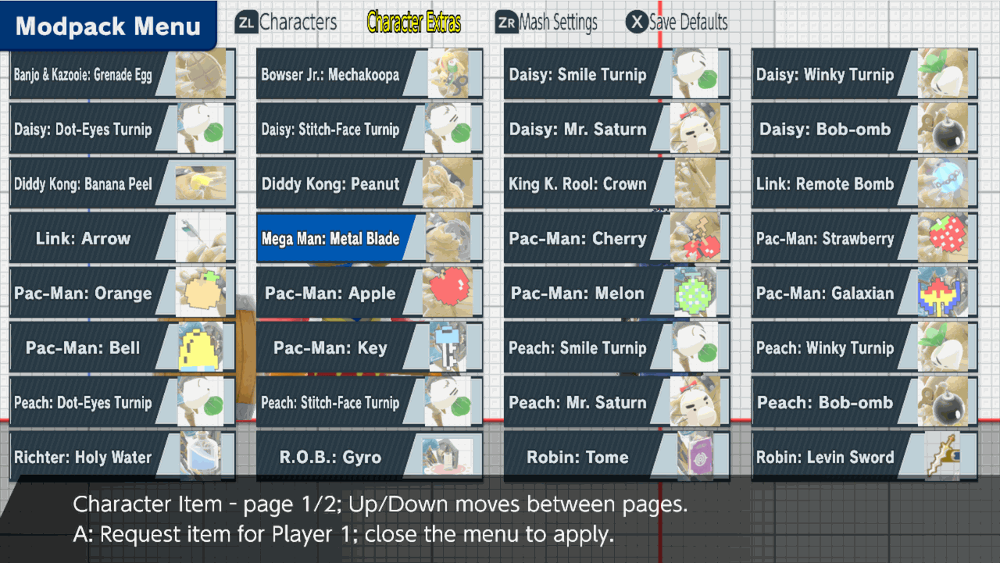

# Character items

Give Player 1 another fighter's item, such as a Peach turnip, Link's Remote Bomb or a Pac-Man fruit, whatever fighter Player 1 is playing. This is part of the [unstable enhancements alpha](experimental-release.md).

## Pick an item

Open **Character Extras → Character Item**. Its two pages group the items by the fighter who normally uses them. Highlight one and press **A**; the button flashes to confirm. Use **Up/Down** to move between pages.

**New in [C89](lobby-parity-release.md):** each icon comes from the item's own game assets.

[See the second page](character-items/page-2.png).

## Get it in hand

Close the menu. The item appears in Player 1's hand, replacing anything Player 1 was holding. There is no lasting check mark, so press **A** on the same item whenever you want a fresh one.

## What is listed

The 38 items come from Banjo & Kazooie, Bowser Jr., Daisy, Diddy Kong, King K. Rool, Link, Mega Man, Pac-Man, Peach, Richter, R.O.B., Robin, Sheik, Simon, Snake, Toon Link, Villager and Young Link. Peach and Daisy each have four turnip faces, Mr. Saturn and a Bob-omb. Pac-Man has all eight bonus fruit.

## Save states

Save with **ZL + D-pad Down** and load with **ZL + D-pad Up** (the defaults). A save keeps the exact item Player 1 is holding, including a turnip's face, and loading gives it back. **Save States → Character Item** is only a fallback for saves made without that record.

## Where it works

Items such as the Remote Bomb or Pac-Man's fruit need their fighter's data, so that fighter is loaded out of sight. This works in ordinary Training with one CPU and in Local Wireless waiting practice; C89 adds Quickplay waiting practice. Items in the real match are unchanged. Bob-omb, Mr. Saturn and the Banana Peel need no source fighter.

Emulator checks covered every listed item with save and restore in Training, Remote Bomb in Local Wireless waiting, and an absent-source Daisy Stitch-Face with save/load in Quickplay waiting. See the [parity validation ledger](plans/lobby-parity.md) for remaining checks.

To learn how the hidden source fighter works, see [How character changes work](character-changes.md#kirby-hats-and-character-items-a-borrowed-fighter).
