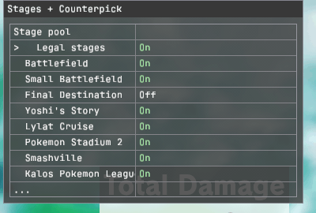

# Stages + Counterpick

This separate Skyline plugin limits the stages the game may pick to the ones you check. It can also give the loser of an online 1v1 their preferred stage on an accepted rematch. It is not part of the Training Modpack download. It is an unstable alpha; physical-console acceptance is pending.

## Install

Download it from the [plugin's releases](https://git.syntaxbyexample.com/intpa/elite-stages-counterpick/releases). Copy `libelite_stages_counterpick.nro` to `sd:/atmosphere/contents/01006A800016E000/romfs/skyline/plugins/` and remove the original Elite Legal Stages NRO, which it replaces. The settings page needs the matching Online Deluxe included in the release bundle.

## Open the page

Hold **L + R** and press **D-pad Down** until **Stages + Counterpick** appears. **Up/Down** chooses a row; hold **ZR** and press **Left/Right** to change it. Both features start Off.

| Row | What it does |
| --- | --- |
| Legal stages | Turns the stage pool on |
| Eleven stage rows | Choose the allowed stages; the last one cannot be cleared |
| Counterpick | Picks the loser's highest-ranked eligible stage on an accepted 1v1 rematch; needs Legal stages |

## Read the status

The rest is status only, so the cursor skips it. **Needs pool** reads Yes when Counterpick is on but the pool is off. In the **Pool | Results | Save** table, a check means ready: **Pool** and **Results** show the game hooks are installed. Under **Save**, a yellow cross means saving and a red cross means a save failed or the file could not be read.

## Edit the files

The settings are in `sd:/ultimate/elite-legal-stages-public/`. Edit the legal stage list in `settings.toml` only with the game closed, because it is read once at boot. An original Elite file works unchanged. Fighter rankings are edited only in `counterpick.cfg`.

The counterpick only changes the stage the game proposes when your **Preferred Rules** are used for that pick; under the opponent's rules the game's choice stands. It never adds a stage the game would not allow. To change a practice stage, use [Practice Stages](practice-stages.md). For formats and test scope, see the plugin's [configuration guide](https://git.syntaxbyexample.com/intpa/elite-stages-counterpick/src/branch/main/CONFIGURATION.md) and [README](https://git.syntaxbyexample.com/intpa/elite-stages-counterpick/src/branch/main/README.md).
