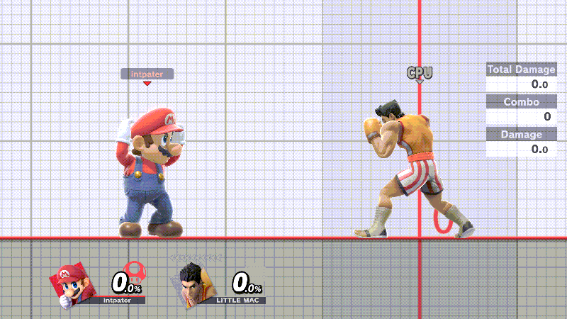
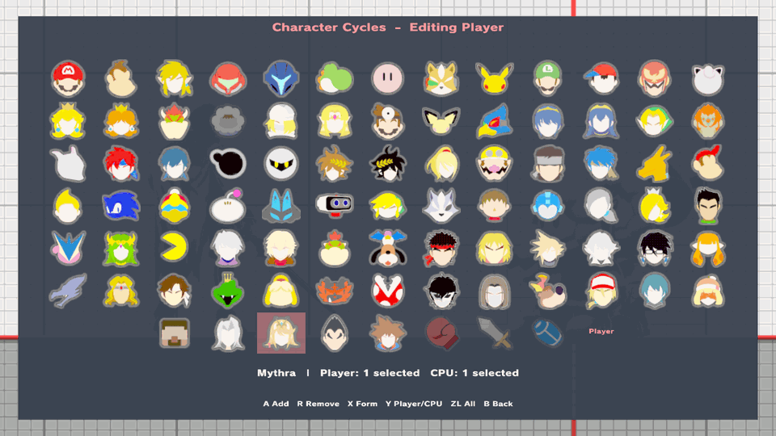
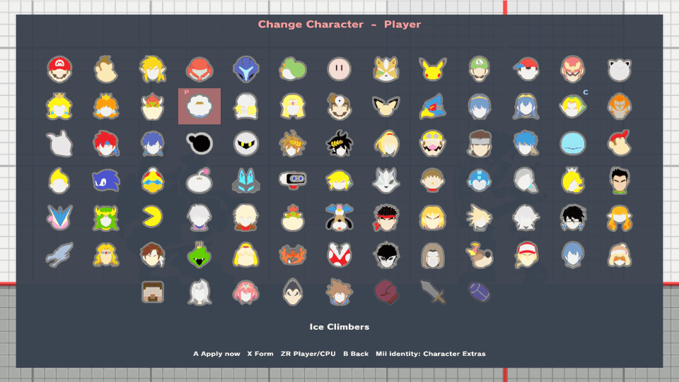

# Hot-swap Player 1 and the CPU

Change your fighter, or the CPU's, during Training without going back to character select. This is part of the [unstable enhancements alpha](experimental-release.md); physical-console acceptance is pending. For waiting-room use, see [Lobby Practice](lobby-practice.md).

## Swap with a shortcut

**ZL + D-pad Left** cycles the CPU. **ZL + D-pad Right** cycles Player 1 once **Characters → Player Swapping** is On. Each press advances one fighter. To change the chords, use **Button Config**.

*Recorded in Linux Eden Training with an earlier development build. P1 cycles from Mario through Solo Popo to Mythra; the CPU changes from Solo Popo to Kirby.*

Player 1 goes through the numbered fighters, then returns to **slot 0**, your character-select pick. The CPU does the same with the fighter it actually started as. A fresh Training visit captures those originals again and starts from slot 0.

## Set the order

Open **Characters → Character Cycles**. Red numbers (top-left) are Player 1's order; blue numbers (top-right) are the CPU's. Changes apply when you close the menu.

| Button | Action | GameCube |
| --- | --- | --- |
| ZR | Switch between Player and CPU | R |
| A | Add, or set the starting form | A |
| X | Preview a Pyra/Mythra or Pokémon Trainer form | X |
| R | Remove | Z |
| ZL | Select All | L |
| Y on Ice Climbers | [Solo Popo](solo-popo.md) for this role | Y |
| B | Back | B |

*Normal Ice Climbers is added as Player slot 2 while original slot 0 stays Solo Popo. The shortcut then goes to Kirby, the pair and original Solo Popo.*

Each role's original fighter shows a grey **0** and cannot be added again, except Player 1's Ice Climbers when its Solo Popo setting differs from the cycle, or a [Mii class with another saved configuration](mii-fighters.md). The CPU's one Solo Popo setting does not open a second Ice Climbers slot. Pyra/Mythra and Pokémon Trainer take one slot each. Down+B still transforms, and the next press moves on.

## Pick a fighter directly

Open **Characters → Player Character** or **CPU Character**, choose a portrait and press **A** to apply it. Neither cycle changes.

*Player Ice Climbers changes to Bowser. CPU Young Link stays the same.*

Save states keep position and damage, not the saved fighter. For defaults, the All order and test scope, see the [hot-swap reference](reference/fighter-hotswap.md).
