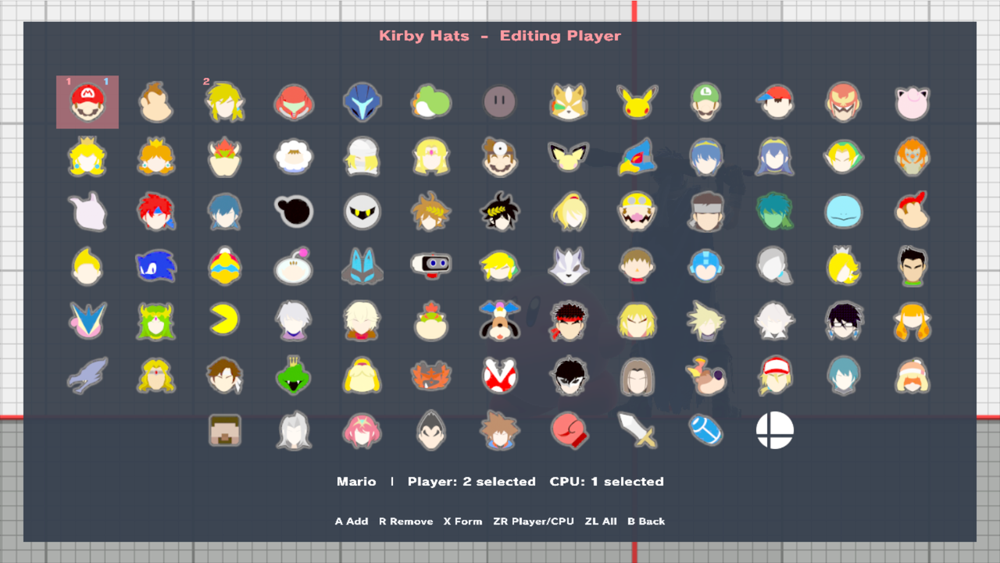
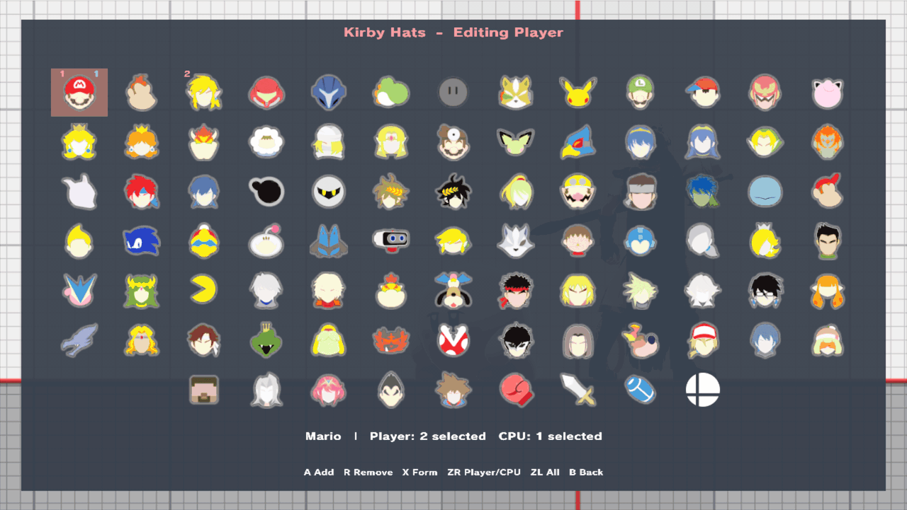

# Kirby hats

Give Kirby another fighter's hat and copied neutral special during practice, for Player 1 or the CPU. That fighter does not need to be in the match. This is part of the [unstable enhancements alpha](experimental-release.md); physical-console acceptance is pending.

## Choose the hats

Open **Character Extras → Kirby Hats**. Red numbers are Player 1's hat order and blue numbers are the CPU's; **ZR** switches roles. **A** adds, **R** removes (Z on GameCube), **ZL** selects All and **X** previews a form. The default list is Mario. Choosing hats does not put one on.

## Put one on

Close the menu. With the left stick neutral, press **L3 + B** (left stick click + Special) for Player 1's Kirby. Press **R3 + B** on Player 1's controller for the CPU's Kirby.

*Two shortcut presses, two copy abilities. Neither source fighter is in the visible match.*

## Next hat, or the same one back

Each press does one of three things for that role:

| Kirby now | The shortcut |
| --- | --- |
| Has no hat from the list | Puts on the first hat |
| Wears the last hat it was given | Moves to the next hat |
| Lost that hat | Puts the same hat back |

If Kirby loses a hat in normal play, the next press restores it instead of skipping ahead.

## Where it works

Hats work for a Kirby picked on character select or swapped in. The hat's fighter is loaded out of sight in ordinary Training with one CPU, or in local-wireless waiting practice. Other scenes report that loading is unavailable. Mii hats use the Mii chosen for that role on the [Mii pages](mii-fighters.md).

Loading a save state gives back the saved hat. When you return to the same local-wireless lobby after a match, each Kirby gets back the hat it wore when the match started.

To learn how the hidden source fighter works, see [How character changes work](character-changes.md#kirby-hats-and-character-items-a-borrowed-fighter).
