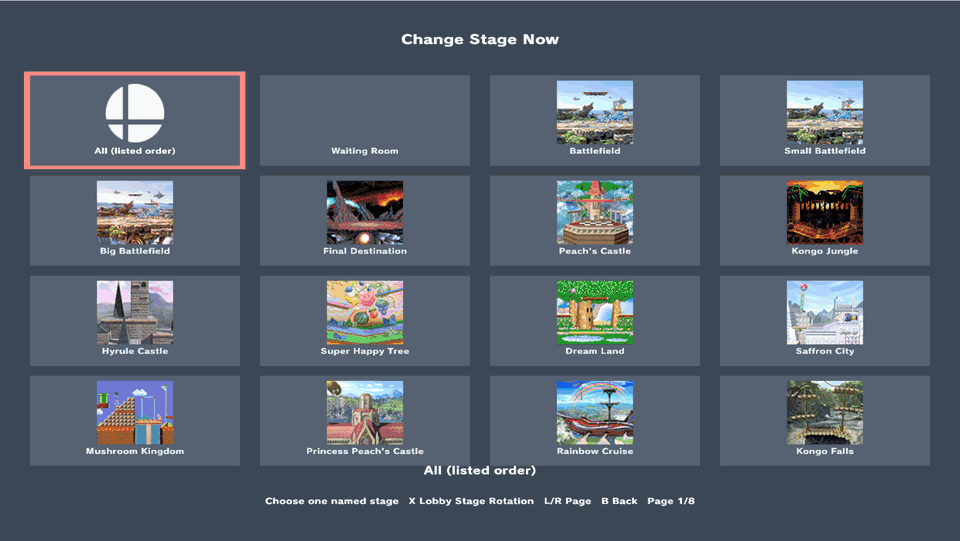

# Lobby Practice and shared character rosters

This independent experimental fork targets Smash Ultimate 13.0.5. It uses the native asynchronous fighter loader to replace one existing practice entry per role. It adds no CSS slots or custom fighter IDs. P1 and CPU use the same mechanism with separate settings. Physical Switch validation remains pending.

## Configure and swap characters

1. Enter ordinary Training. Press **Minus** to open the Modpack Menu. **B + D-pad Up** remains available; the two optional [INI shortcuts](menu-shortcuts.md) default to Minus and disabled. Plus opens the native pause menu unless explicitly configured otherwise.
2. In the development build, open **Characters → Player Swapping** and enable P1 replacement.
3. Use **Player Character** or **CPU Character** in that same tab for a one-time replacement.
4. Open **Character Cycles** for the shared portrait grid. Both orders stay visible: red P1 numbers at top-left and blue CPU numbers at top-right. **ZR** switches the role being edited (**R** on GameCube). **A** adds or updates a group, **R** removes (**Z** on GameCube), and **ZL** selects All (**L** on GameCube). **X** previews the starting form for Pyra/Mythra or Pokémon Trainer; **A** commits it. **Y** on Ice Climbers toggles Solo Popo for the active role, even on P1's grey original portrait.
5. Close with **B** to commit. Fighters load without leaving practice; no matching first CSS choice or re-entry is needed.

Defaults: **P1 G&W → Palutena → Pikachu**; **CPU Pikachu → Kirby → Bowser → Bayonetta**. Existing ordered rosters and older fixed-slot selections migrate when loaded. New saves write only ordered rosters, which earlier ordered-roster builds can also read. Earlier fixed-slot-only development builds cannot recover edited rosters from the new file; keep a backup if downgrading to those builds.

All follows the character-select rows, left to right and top to bottom, with each transforming group once and its configured starting form preserved (defaults: Pyra and Squirtle). P1's original character-select group is **slot 0**, visited after the last numbered fighter and before slot 1. It is normally grey and excluded from the numbered list and All. The enhancements alpha permits an Ice Climbers numbered entry when its red S differs from Character Extras → Solo Popo; identical configurations remain grey. The CPU's original fighter stays selectable, including in CPU All. Cycle selections show numbered order; remove and add a group to move it to the end. Selecting a fighter while All is active starts a custom sequence. Directional inputs move the marker across the portrait grid. There is no eight-character limit.

Default mappings are **ZL + Right** for P1 and **ZL + Left** for CPU. Configure them under **Button Config → Cycle Player Character / Cycle CPU Character**. Holding a mapping advances only once. P1 wraps through the original slot 0 and its original starting form. The CPU wraps its own list, starting at its first choice if its current fighter is outside it.

Pyra/Mythra occupies one cycle slot, and Pokémon Trainer occupies one slot. Each starts in the chosen form; normal Down+B transformations remain available. The next hot-swap advances to the next group regardless of the current form, and returning restores the configured starting form. Ice Climbers is supported; Saved-Mii cycling, the native Mii editor and managed Mii hats are available in the full alpha. See the [release limits](experimental-release.md). The portrait layout matches the all-unlocked save used for testing; it does not read arbitrary save layouts. These are plugin roster settings, not new game slots. Coverage is representative, not every character/costume/move combination. The [portrait asset manifest](../scripts/roster-grid/assets/sources.json) records the stock icons supplied by SmashWiki.

Solo Popo has three independent saved settings. **Character Extras → Solo Popo** controls only P1's original character-select Ice Climbers. **Red S, bottom-left** controls cycled-in P1 Ice Climbers; **blue S, bottom-right** controls CPU Ice Climbers of either origin. An S is shown only when enabled. Y still edits the red S on P1's grey slot-0 portrait without changing the current original P1 or Character Extras. Changing the applicable setting switches the pair/Solo state when the menu closes. See the [Solo Popo guide](solo-popo.md). These settings passed the Training and solo local-wireless checks described below.

## Lobby Practice and presentation

Enable **Misc Settings → Lobby Practice → On**, close the editor, and enter the waiting practice area. The editor appears as Lobby Practice. The waiting-enabled build uses the waiting-roster-reload feature; ordinary Training remains available without it.

*Recorded with the enhancements development build in an emulator's local-wireless
waiting room. P1 cycles from Solo Popo through Mario to Donkey Kong; the CPU
changes from Solo Popo to Sheik and its icon updates. The lower player card
retains the original Ice Climbers match selection.*

Actual matches use the original character-select choice, regardless of P1's practice replacement. The lower waiting roster card intentionally shows that match selection. CPU replacements affect the local practice dummy. Practice shortcuts and hooks are disabled in an actual match.

The current development build remembers each role's last successfully loaded practice
character for the lobby. After a match, it restores those choices when fresh waiting
entries are ready. Native dialogs, another load and pending practice actions defer
restoration; a new explicit character request takes priority. P1 restoration requires
Player Swapping to remain enabled. An interrupted load does not replace the last
completed choice. Creating a fresh lobby clears both choices; ordinary Training has
its own live selections. This is in-memory session state, not a saved CSS override.
An earlier development build passed a two-peer local-wireless match/return and fresh-room
reset test. Online-arena and physical Switch runtime remain unverified for this change.

The waiting CPU's small character icon is refreshed after replacement. Waiting HUD resource callbacks preload the supported stock icons before the game's normal load barrier. The refresh obtains the current generation-checked UI, maps its presentation ID to the visible partner, and calls the native texture setter. It retains no pane pointers and changes no partner or matchmaking descriptor. The icon uses the character's default-costume image.

Ordinary Training portrait and name update immediately. Native **L + R + A** reset retains the current fighter there. Save/load, recording/playback, native Training reset and some stage options remain ordinary-Training features; the waiting menu labels their scope. Native lobby dialogs take input priority.

## Practice stages

Open **Misc Settings → Practice Stages**. In Training it starts at **Change
Stage Now**: choose a named stage and press **A** to change the active stage
without returning to character select. Both **Waiting Room** and the actual
**Training** stage are included. **L/R** moves one page at a time.

Press **X** to edit **Lobby Stage Rotation** in the same menu. Pick stages in
the order you want to visit them. Rotation advances on the next lobby-practice
entry, including after a match or a return through character select; it does
not rotate an ordinary Training session. **X** returns to direct selection.

*Recorded in ordinary Training. The clip shows L/R paging, the separate rotation
view, and the complete direct stage transition. The loading pause is retained.*

## Save states, recording and lifecycle

Default save/load shortcuts are **ZL + Down / ZL + Up**. A save restores generic position/damage into the current fighter; it does not restore the saved fighter kind. Character-specific charge restores only for matching kinds.

Save loading, recording/playback, native UI, another character replacement and pending training actions block conflicting swaps. A replacement clears per-session training state. Requests are bound to the observed entry identity and scene epoch. Native destruction invalidates queued/active references before the original destructor runs. No manual loader pumping or forced cancellation is used.

## Installation and diagnostics

With the game stopped, replace the existing Training Modpack NRO; never load two copies. The waiting editor is packaged in the NRO:

    sd:/atmosphere/contents/01006A800016E000/romfs/skyline/plugins/libtraining_modpack.nro

Preserve the existing training_modpack_menu.conf, saves, other plugins and emulator settings. No separate info_waiting.arc installation is needed; any old copy is ignored. The NRO reconstructs the accepted waiting UI from the game's loaded stock archive, its existing embedded Training UI and a small compiled patch. Input and output fingerprints must match before injection; a mismatch leaves Lobby Practice inactive and logs the reason. The first reconstruction result and its owned allocation are cached for the process lifetime. Fully restart the game after replacing the NRO.

This is a single-file Training Modpack update within an existing Skyline installation; it does not replace Skyline or unrelated plugins. The player and CPU share one ordered-roster implementation. The retired fixed-three P1 implementation is absent; three defaults are just an initial selection.

Persistent logs are sd:/ultimate/TrainingModpack/practice-diagnostics.log and practice-diagnostics.previous.log. Rotation keeps two files of at most 128 KiB each. Records include build/version, scene, request/entry identity, loader phase, completion, HUD/icon refresh, destruction, save/record events and Rust panics. Preserve both files and Atmosphère crash reports after a fault, along with exact NRO hashes, game version, fighter/costume choices and last action. A native fault can prevent the final record.

## Rebuilding the waiting UI patch

The shipped patch is src/static/waiting_ui.patch. It is a bounded copy/literal recipe, not a second full archive. Regenerate it only against a validated target when the embedded Training UI or supported stock archive changes:

    python3 scripts/make_waiting_patch.py STOCK.arc src/static/layout.arc ACCEPTED-WAITING.arc src/static/waiting_ui.patch --report PATCH-REPORT.json

The generator checks reconstruction and records SHA-256 hashes; scripts/waiting_patch_manifest.json pins the accepted inputs and output. Compare the new report before committing a regenerated patch. The runtime separately checks source lengths/fingerprints, copy ranges, maximum output size, and exact output length/fingerprint. The private validation inputs remain outside the repository. The development-only layout_arc_from_file feature affects ordinary Training; waiting reconstruction always uses the pinned embedded donor. The decoder unit tests use synthetic data; the private fixture check also runs the actual Rust decoder against the accepted archive.

## Validation

The earlier native-reload build passed ordinary P1/CPU reload, ordered/All menus, representative moves, save/record conflicts, reset and re-entry. Both native LDN host roles versus a vanilla peer produced matching combat and results. A separate test destroyed the waiting CPU during an active Bayonetta load; references were invalidated and the actual match retained original CSS G&W.

The subsequent CPU-icon correction updates the waiting portrait after a swap. Current reproduction evidence is linked in the development validation page below. Physical Switch repeated swaps, transitions, restarts and vanilla-peer desync checks remain required. Emulator/LDN passes do not establish Nintendo online-service or ban safety. One controller per peer is the exercised scope.

The embedded waiting-UI build passed with the external waiting archive removed: ordinary Training editor and P1/CPU swaps; waiting editor, P1/CPU swaps and CPU icon; native LDN against a vanilla guest with original G&W selection and matching combat/results; and a second waiting load that reused the cached UI and reopened the editor. The actual Rust decoder also reproduced the accepted archive byte-for-byte. Three decoder tests, warning-free all-target NRO Clippy and the no-default-features release build passed. Save/record and actual mid-load interruption evidence remained the earlier regression checks; those cases were not repeated for the embedded waiting-UI build.

The enhancements development build passed strict root all-target Clippy with warnings denied, release and no-default-features builds, plus 150 host suite tests and 5 independent probes. Native Training passed the original-P1/red-S distinction, immediate Character Extras pair/Solo toggles, independent CPU blue S, automatic Solo after readiness, Solo save/load, actual P1 and CPU KO/Solo respawn, native Mario → cycled Solo Ice Climbers, and Mythra → Pyra → next Charizard → Squirtle → next original Mario 0. See [development validation](character-cycles-validation.md#enhancements-development-build--2026-10-16). The same build also passed solo local-wireless checks for independent Solo settings, dual cycle orders, All, P1/CPU swaps, CPU form selection and CPU-icon updates. Earlier two-peer LDN results above retain their original scope; a new two-peer match/return, online-arena and physical Switch pass is not claimed.

## Earlier hardware hardening

The native Training-menu object is no longer cached for later HUD access. Version-checked hooks copy the game's combo-display setting into an atomic boolean at the native read sites; HUD drawing consumes only that scalar. The stale-moves setting write now uses the game's byte width. This removes an inherited lifetime hazard without claiming it caused any particular earlier crash. The rest of the fighter/module/scene lifetime assumptions still require physical Switch testing.

The corrected separate G&W plugin is v0.1.1-experimental. Its earlier 0.1.0 binary has a known hardware SVC-clobber defect and must not be deployed. See the separate plugin's validation notes; the corrected release still needs physical confirmation.

## Source cleanup

The superseded lobby/trio investigation plugins remain in repository history and the local research archive. The normal NRO retains the five entry lifecycle and portrait hooks it needs in character_lifecycle.rs, along with persistent crash diagnostics. Scene, entry identity, destruction, ABI/version and conflicting-action checks remain in place.
Roster settings now have one stored representation per player. A shared JSON importer validates the retired fixed-slot values and converts them once; the editor and runtime then use the same ordered roster. Invalid legacy values still reject the file even when a modern roster is present. Required upstream fields remain required, and duplicate menu keys are rejected.
