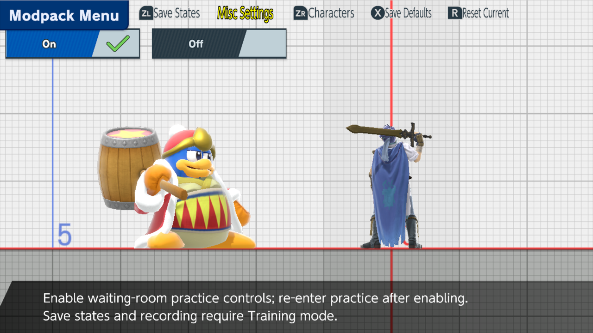

# Lobby Practice

Practice in a waiting room as well as in Training: swap your fighter or the CPU while you wait for a match. The match itself still uses your character-select pick. This is part of the [unstable enhancements alpha](experimental-release.md); physical-console acceptance is pending.

## Turn it on

Open the menu with **Minus** (or **B + D-pad Up**) and set **Misc Settings → Lobby Practice → On**. Close the menu, then leave and re-enter the waiting room's practice area.

## Swap while you wait

The [hot-swap](fighter-hotswap.md) controls work here too. Press **ZL + D-pad Right** for Player 1 (with **Player Swapping** On) and **ZL + D-pad Left** for the CPU. The CPU's small icon updates. The lower player card keeps your real match pick.

*Local-wireless demonstration: both practice fighters change; the lower card keeps the original match pick.*

## After a match

Practice shortcuts are off during the real match. When you return to the same lobby, each role's last practice fighter reloads, along with the hat each Kirby was wearing. Player 1's fighter returns only if Player Swapping is still On. A new lobby starts fresh.

## Training-only tools

Save states, recording and playback, native Training reset and some stage options need ordinary Training. The waiting menu marks them, and lobby dialogs take priority over practice input. To change or rotate the waiting-area stage, use [Practice Stages](practice-stages.md).

Swaps were tested in emulator local-wireless waiting rooms; online arenas are not established. For installation, diagnostics and validation, see the [Lobby Practice reference](reference/lobby-practice.md).
