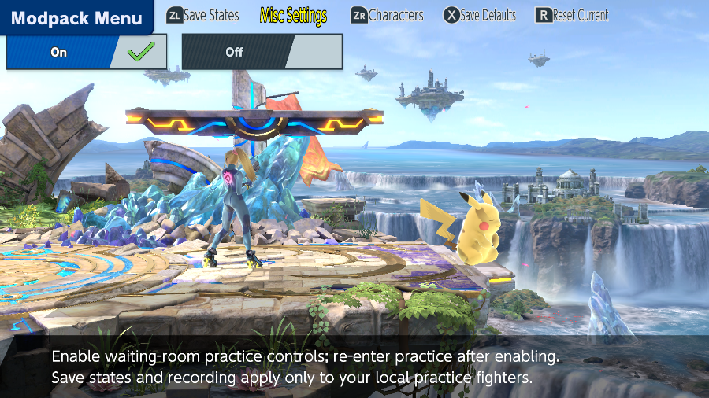
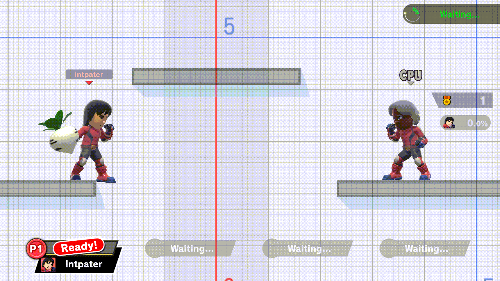
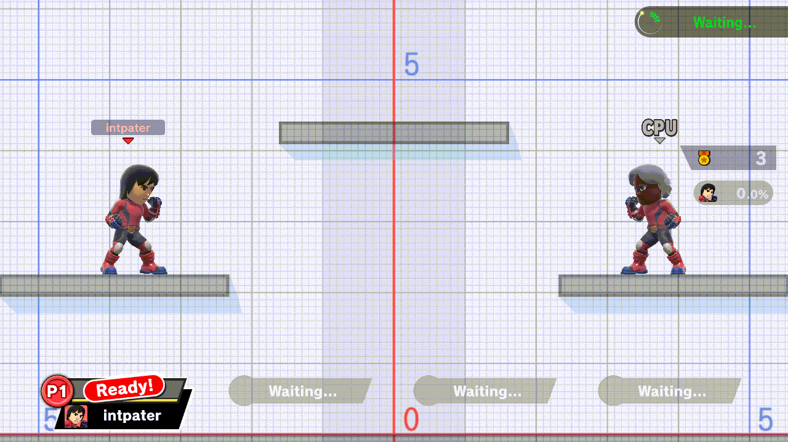

# Lobby Practice

Practice while Quickplay or Local Wireless waits for another player. Swap fighters, save a position, replay inputs, or try a different stage. The match itself still uses your character-select pick.

This page describes the **lobby-parity development branch**. Its [22 gameplay checks](plans/lobby-parity.md#required-behavior) are complete in the documented emulator/shared-code scope. Physical-console acceptance is pending.

## Turn it on

Open the menu with **Minus** (or **B + D-pad Up**) and set **Misc Settings → Lobby Practice → On**. Close the menu, then leave and re-enter the waiting room's practice area.

## Swap while you wait

The [hot-swap](fighter-hotswap.md) controls work here too. Press **ZL + D-pad Right** for Player 1 (with **Player Swapping** On) and **ZL + D-pad Left** for the CPU. The CPU's small icon updates. The lower player card keeps your real match pick.

*Emulator local-wireless room: Player 1 cycles from Solo Popo to Mario and Donkey Kong; the CPU changes from Solo Popo to Sheik and its icon updates. The lower card still shows Ice Climbers, the real match pick.*

## After a match

Practice shortcuts are off during the real match. When you return to the same lobby, each role's last practice fighter reloads, along with the hat each Kirby was wearing. Player 1's fighter returns only if Player Swapping is still On. A new lobby starts fresh.

## More practice tools

| Try this while waiting | Open or press |
| --- | --- |
| Save / load positions, damage and held items | **ZL + D-pad Down / Up** by default |
| Reset the practice fighters | **L + R + A** |
| Record inputs, play them back, or edit a named macro | [Recordings and macros](named-macros.md) |
| See hitboxes and hide CPU tech animations | Their usual modpack settings |
| Change the stage or its form, hazards, or lobby rotation | [Practice Stages](practice-stages.md) (**Y** cycles the form) and **Stage Hazards** |
| Try Kirby hats, character items or saved Miis | **Character Extras** |

A match starting takes priority over these tools. An active recording stops, and practice input is off during the match. An unfinished macro name or Mii editor draft resumes exactly when you return to the same lobby. Explicitly cancelling an editor still cancels it without saving.

### Restore a held item and position

1. Save your setup with **ZL + D-pad Down**.
2. Throw the item and move away.
3. Press **ZL + D-pad Up** to restore the saved setup onto the current fighters.

*Local Wireless waiting practice: the same Daisy Stitch-Face Turnip returns after the throw and movement. The real-match Ready card stays unchanged.*

### Play a recording automatically from the ledge

A numbered recording can be used as a CPU ledge option. This example uses a short **A**-tap recording with looping off: after catching the ledge, the CPU plays it, performs a getup attack and returns to idle. Player 1 stays still.

These clips come from completed emulator checks. [Footage provenance](lobby-practice/SCREENSHOTS.md).

Online arenas are not established. For mode-specific test results and troubleshooting, see the [Lobby Practice reference](reference/lobby-practice.md).
