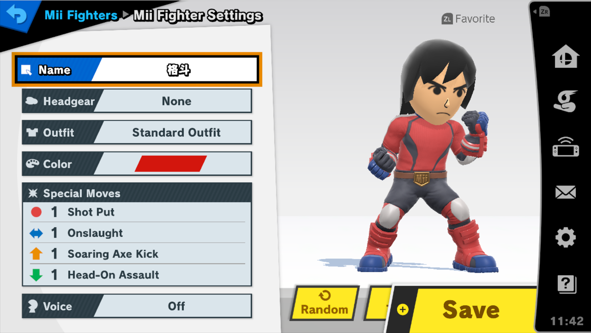

# Mii Fighters

Choose which saved Mii Fighter Player 1 and the CPU use, make a new one with Smash's own editor, and practice against Miis from your saved replays. This is part of the [unstable enhancements alpha](experimental-release.md); physical-console acceptance is pending.

## Choose a Mii for each role

Open **Character Extras → Mii Brawler**, **Mii Swordfighter** or **Mii Gunner**. Each page has **Player**, **CPU** and **Add New**. The lists show each Mii's special moves, such as `[2111]`. Choosing one never edits the saved Mii.

![Selecting Replay Brawler [2111], cycling to that Mii, and performing Flashing Mach Punch.](feature-walkthroughs/mii-selection.gif)

*Replay Brawler is chosen for Player, then loaded by the cycle shortcut. Neutral B uses its punching flurry.*

## Use it in a cycle

Add the class portrait in **Characters → Character Cycles**. When the [cycle](fighter-hotswap.md) reaches it, that role loads the Mii you chose. If that class is on screen now, it reloads when you close the menu; other choices apply on a later cycle. Player 1's own character-select Mii stays at slot 0, so it is greyed in the Player list.

## Make a new Mii

**Add New** opens Smash's Mii Fighter editor with a copied starting configuration; **Test** works as usual. The editor's **Save** creates a normal Smash Mii. Leaving without saving creates nothing, and the copied Mii never changes.

In an online (Quickplay) waiting room, the pages offer only Add New, and Headgear, Outfit, Color, Voice and Random work in Training only. If a match interrupts the editor, the same screen reopens with your unsaved changes when you return to waiting practice.

## Opponents from your replays

With [replay capture](named-macros/README.md) on, Save Replay also keeps each fighter's Mii. When you choose that opponent's capture in Training, the CPU loads the exact Mii. A Mii that is not already in your Smash list is kept once in the modpack's own list. It is never added to Smash's list.

## Known limit

After a Mii swap, the small HUD portrait can still show the previous Mii; the body and special moves belong to the new one. A portrait fix is still pending.

For storage and matching rules, see [How character changes work](character-changes.md#miis).
