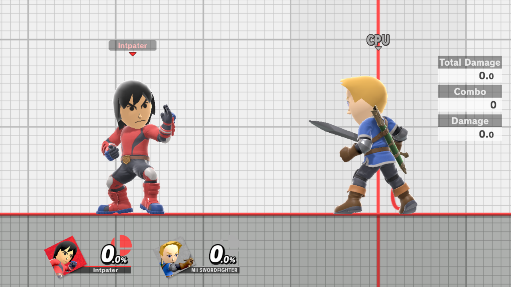

# Mii Fighters

Choose which saved Mii Fighter Player 1 and the CPU use, make a new one with Smash's own editor, and practice against Miis from your saved replays. This is part of the [unstable enhancements alpha](experimental-release.md); physical-console acceptance is pending.

## Choose a Mii for each role

Open **Character Extras → Mii Brawler**, **Mii Swordfighter** or **Mii Gunner**. Each page has **Player**, **CPU** and **Add New**. The lists show each Mii's special moves, such as `[2111]`. Choosing one never edits the saved Mii.

![Selecting Replay Brawler [2111], cycling to that Mii, and performing Flashing Mach Punch.](feature-walkthroughs/mii-selection.gif)

*Replay Brawler is chosen for Player, then loaded by the cycle shortcut. Neutral B uses its punching flurry.*

## Use it in a cycle

Add the class portrait in **Characters → Character Cycles**. When the [cycle](fighter-hotswap.md) reaches it, that role loads the Mii you chose. If that class is on screen now, it reloads when you close the menu; other choices apply on a later cycle. Each role's own character-select Mii stays at that role's slot 0 and is greyed only in that role's list. A class with no admitted Mii does not show 0.

## Make a new Mii

**Add New** opens Smash's Mii Fighter editor with a copied starting configuration; **Test** works as usual. The editor's **Save** creates a normal Smash Mii. Leaving without saving creates nothing, and the copied Mii never changes.

The **lobby-parity development branch** enables these pages in Quickplay and Local Wireless waiting practice, including Player/CPU selections and the editor's cosmetic options. A match takes priority; afterward the editor resumes its unfinished screen without saving. Emulator checks covered interrupted cosmetic choices in Quickplay and an unfinished Specials draft across a real Local Wireless match ([validation ledger](plans/lobby-parity.md)). Explicit Cancel leaves without saving.

## Opponents from your replays

With [replay capture](named-macros.md#turn-on-capture) on, **Save Replay → enter Training** adds an unfamiliar opponent's Mii to the modpack library, or reuses an identical saved Mii. No replay playback is needed. [Watch both cases.](mii-replay-discovery/README.md)

## Matching portraits

In Training, Player and CPU HUD portraits follow the selected Mii's face, outfit and colors, rendered by Smash itself. On the **lobby-parity development branch** (C89), Miis with changed headgear also load that equipment for either role and get their own portrait rather than the generic class one; switching between two Miis of the same class reloads normally. Local Wireless waiting practice updates the CPU icon too. The **lobby-parity development branch** adds Quickplay's CPU portrait; the Ready card continues to show the character-select fighter for the real match.

For storage and matching rules, see [How character changes work](character-changes.md#miis).
