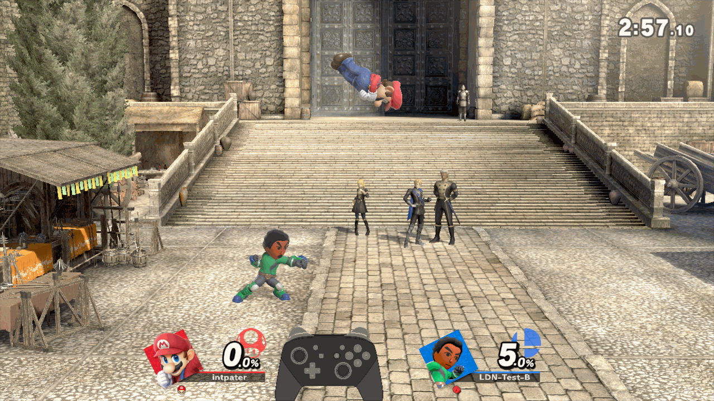
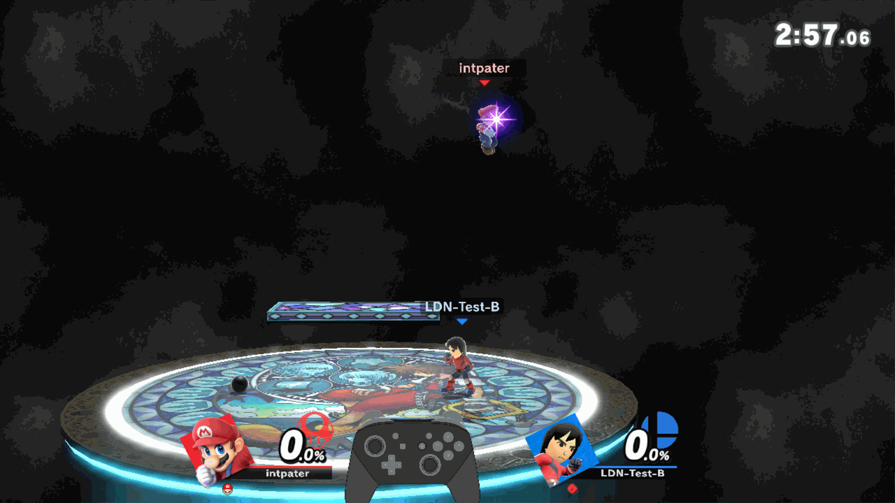

# Keep an opponent's Mii

**[Unstable enhancements alpha](../experimental-release.md).** Save the match, then enter Training: the opponent's Mii becomes available automatically. You do not need to watch the replay. Physical-console acceptance is pending.

Before starting Smash, enable [replay capture](../named-macros.md):

```ini
# sd:/ultimate/TrainingModpack/replay_capture.ini
[capture]
enabled=on
```

1. Finish the match. On the **two result cards**, press **Y → Save Replay** and confirm.
2. Enter **Training** without closing Smash. Let the fighters finish loading and wait a moment with the menu closed.
3. Open **Character Extras → Mii Brawler / Swordfighter / Gunner → Player or CPU**.

## A Mii you do not have

The green Brawler uses `[2111]`. After saving the match, **Replay Brawler [2111]** appears beside the existing `[1111]` Brawler.



## A Mii already in your save

The red Brawler matches the saved **格斗 [1111]**. Saving this match reuses that Mii: the list still contains the same two entries.



*Both clips show real matches followed by Training; navigation between them is cut. Matching compares class, appearance and moves, not the name. New discoveries stay in the modpack library, leaving Smash's own Mii list unchanged.*

If the Mii does not appear—for example, you closed Smash first—choose its track in **Input Recording → Replay Window** to retry from the saved capture. Playback is still unnecessary.

Next: [choose that Mii for a character cycle](../mii-fighters.md#use-it-in-a-cycle), or [turn its captured inputs into a CPU macro](../named-macros.md).
