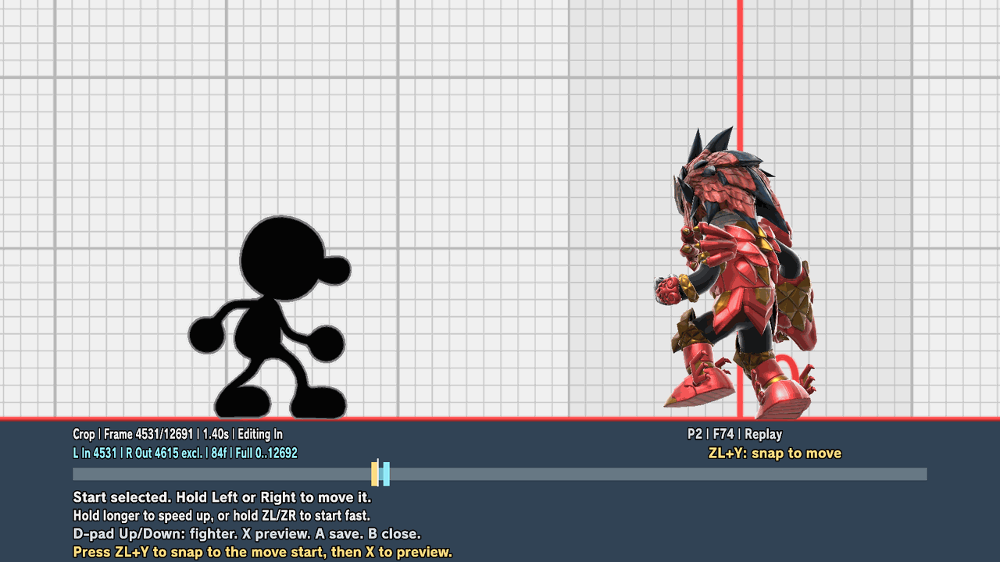
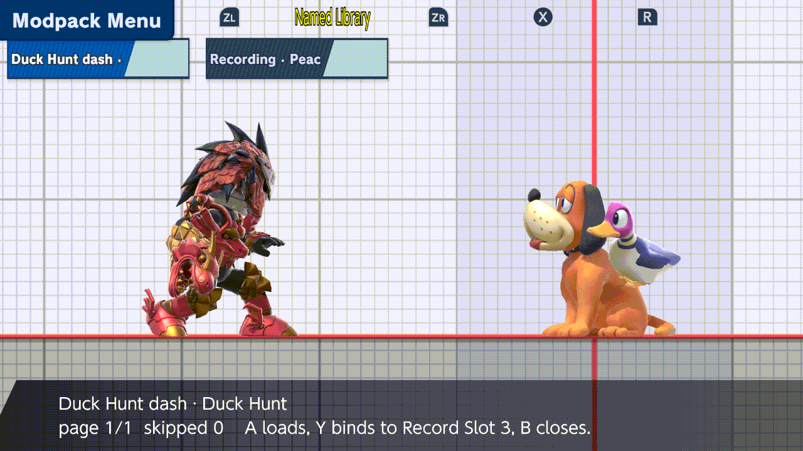
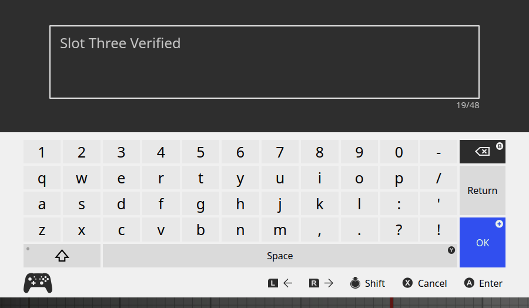

# Named CPU macros

Save a match, open it in Training, pick either captured player, crop the part
you want, and let the Training CPU play those inputs. Pick your opponent to
practice against their inputs.

The opening examples use Kirby (P1) against Hero (P2). The middle-crop example
below uses an older saved match against an armored Mii Gunner:


Macro preview and playback run in Training. Full controls, physics, files and
test evidence are in the [reference](reference/named-macros.md).

## Turn on capture

Do this before starting Smash. The modpack creates
`sd:/ultimate/TrainingModpack/replay_capture.ini` on its first run, with capture
off. With the game closed, set:

```ini
[capture]
enabled=on
```

## Save the match

Play a match, then use the game's **Save Replay** on the results screen. The
capture is kept only if Save Replay succeeds. You do not need to play the
replay in the Vault.

## Open the capture

In Training, open **Input Recording → Replay Window → Replay Captures**. Each
entry is the replay name and its length in frames, here **Replay · 8299f**.
Press **A** to open it. Saved captures stay available after a restart, even with
capture turned off. For an older replay without a capture, play the desired
section once in the Vault, then open Replay Window without restarting Smash.
[Vault fallback](reference/named-macros.md#vault-fallback) explains the steps.


## Choose the fighter

**D-pad Up/Down** switch between the captured players. P1 and P2 are players in
the saved match, not your current controllers. Only the inputs play, so any
fighter can use them. If the player you pick used a different fighter than the
CPU, a prompt asks once: **Keep current fighter** (the default) or **Switch to
recorded fighter**. **B** cancels and leaves your previous selection. With
**Input Recording → Fighter Prompt** off, the CPU is never changed and nothing
is asked. Results differ naturally when the fighter differs.


Closing the editor without saving or previewing keeps that fighter. **L + R + A**
resets positions while keeping its matching portrait, including an exact replay Mii.

## Crop

Press **L** for the start or **R** for the end, then hold **Left** or **Right**;
the step speeds up the longer you hold. Hold **ZL** or **ZR** to start fast.

If In lands mid-action, press **ZL+Y** to snap to that move's start and include
its short setup, such as a jump before an aerial. Existing captures work too.
Here the Gunner crop snaps **4531 → 4470**, then **X** plays the nearby forward
smash. It does not return to the match opening.



## Preview

After **Switch**, wait for the fighter to finish loading. Then press **X**. The editor saves a
temporary preview setup of both fighters by itself; you do not need to save a
state first, and your five save-state slots are not changed. **Y** restarts, and
after you move In or Out, **X** plays again from the same spot. **X** again or
**B** stops and puts the fighters back; closing the editor discards the
temporary setup. When X refuses, the reason appears in the editor's wide help
strip, not in a small notification.

Both clips use **In 0 / Out 449**, the match opening above. They start from the
current Training positions, so hits and timing differ from the match.

**P1 / Kirby's** inputs on the Training CPU, with King Dedede as the Training
player:


**P2 / Hero's** inputs: select P2 and wait for Hero to load before previewing.


## Name and keep it

When the preview looks right, press **A** once. The keyboard suggests the replay name plus the player, such as
**Replay P1**; enter a name and press **Plus**. This clip exports the P1 crop as
**Kirby opening** and finds it in the named library.


## Record and load

1. Set **Input Recording → Macro Source** to **Named Library**.
2. In **Input Recording → Named Library**, press **A** on a recording
   (**A Load from file**). That reads the file and readies it for playback; it
   does not start it. If its fighter differs from the CPU you get the same
   **Keep current fighter / Switch to recorded fighter** choice as above.
   After **Switch**, close the menu and let the change finish.
3. Save the Training setup you want, then press **Input Playback** (default
   **ZR + D-pad Up**). The setup is restored, then the inputs play on the CPU.
   Unlike the editor preview, playback uses this saved setup.

To record by hand instead, keep **Named Library** as the source and press
**Input Record** (default **ZR + D-pad Down**) to start and again to finish, then
name it. The clips on this page show replay exports, not hand recording.

## Share a numbered Record Slot

The five numbered **Record Slots** can go in and out of the named library. In an
emulator check, a 51-frame recording was copied into Record Slot 3 and saved back
out unchanged apart from its new name. Console testing is pending.

**Copy a named recording into a slot.** Set **Input Recording → Recording Slot**
(here **3**), open **Named Library**, highlight a recording and press **Y**
(**Y Copy to Record Slot 3**). This copies the recording and its starting information into the slot; it
does not select it for named playback (that is **A**).



**Save a slot as a named file.** Choose **Input Recording → Save Slot to
Library**, type a name and confirm with **OK**.



- Y copies recordings of 600 frames or fewer. A longer one is refused and the
  slot keeps what it had; play it from the named library instead.
- An empty slot is refused: **Record into this slot first**.
- A Mii Fighter recording keeps that Mii's exact look from when recording
  started. If the game did not report the look at that moment, saving is
  refused. Record the slot again.

To save the whole fighter setup instead of inputs, see
[Setup Library](setup-library.md).

## Placement

**Input Recording → Edit Placement** moves where a loaded macro starts,
relative to the CPU's restored position, and can keep or clear its recorded
momentum. See the [placement controls](reference/named-macros.md#placement).

## Vault fallback

Optional. Only for older or imported replays, matches saved with capture off,
or a replay without a capture: play it in the Vault, then open the Replay Window
in the same game session. See the [Vault steps](reference/named-macros.md#vault-fallback).

## More

- [Reference](reference/named-macros.md): all controls, placement and files
- [Setup Library](setup-library.md): named, shareable save-state setups
- <a name="capture-a-match-optional"></a>[Capture and file format](reference/named-macros.md#capture-a-match-optional)
- <a name="replay-window-controls"></a>[Replay Window controls](reference/named-macros.md#replay-window-controls)
- <a name="direct-file-import"></a>[Direct file import](reference/named-macros.md#direct-file-import)
- <a name="test-record"></a>[Test record](reference/named-macros.md#test-record)
- [Build inputs](named-macros-build.md)
- [Image provenance](named-macros/SCREENSHOTS.md)
