# Named CPU macros: a screenshot walkthrough

Turn one fighter's replay inputs into a reusable Training drill, or record a new
drill by controlling the CPU. Give it a name, load it from the library, and play
it from your saved Training setup with adjustable position and starting momentum.

**Development preview · Updated October 14, 2026.** These are real captures from
native game tests of the local implementation. Native input preview has passed the
scoped emulator checks below. The current plugin is installed on a development
Switch for continued testing. This tree contains the walkthrough alongside the
implementation source.

The implementation source is in this tree; see
[docs/named-macros.md](../named-macros.md) and
[docs/named-macros-build.md](../named-macros-build.md). The revision 27
qualification archive remains in commit
[`86a1426`](https://github.com/crashbandicode/UltimateTrainingModpack/commit/86a1426597246a2d0b36e9e652878053efea38a0).
Performance qualification is still in progress.

## Implemented features

- **Named CPU recording:** possess the CPU, record up to ten minutes, optionally
  trim trailing neutral input, and save reusable drills without a five-slot limit.
- **Persistent library:** browse/load recordings, request their CPU fighter, and
  remember the selected recording across restarts.
- **Native naming keyboard:** confirm a name to save; cancel or invalid-name
  validation keeps the draft available for another attempt.
- **Replay capture:** retain the latest and previous observed captures in memory,
  select one fighter, and export an exact input window.
- **Optional persistent live capture:** enable an INI switch, save the corresponding
  native replay, then select its companion under the replay name in Training—even
  after restarting the game. Capture defaults off; Vault remains the fallback.
- **Native input preview:** run the selected inputs through the Training CPU so
  movement, attacks, projectiles and effects happen normally. Play, Stop and Restart
  use a saved Training setup; progress follows emitted inputs.
- **Crop editor:** independent In/Out boundaries. D-pad Left/Right moves the
  selected end, and the step grows the longer that direction is held. Hold ZL or
  ZR (Z on a GameCube controller) to begin already fast. A diagonal press keeps
  editing the end instead of changing fighters. Editing the range does not seek
  the game.
- **Placement and playback:** restore a Training setup, apply relative whole- or
  quarter-unit offsets, preserve recorded momentum or start at rest, and mirror
  horizontal inputs/momentum with facing. Temporary edits, overwrite and Save As
  are available.
- **Preview lifecycle:** grounded acquisition after character loading, P1 input
  isolation, standard HUD/statistics hiding, and restoration of both saved fighters
  after Stop, range edits or close.

## Capture a new match and keep it across restarts

This optional route avoids replaying the match in Vault before making a macro.

1. Run the mod once to create
   `sd:/ultimate/TrainingModpack/replay_capture.ini`. With the game closed, change
   the default `off` to `on`, then restart:

   ```ini
   [capture]
   enabled=on
   ```

2. Play the match and confirm the game's **Save Replay** action on the results
   screen. The companion capture is published only after that exact native replay
   save succeeds. Cancelling creates no companion; unsaved RAM data is not persistent.
3. Enter Training, including after closing and restarting the game. Open **Input
   Recording → Replay Captures**, select the native replay name, and press **A**.
   Saved choices remain available with capture switched off on a later restart.

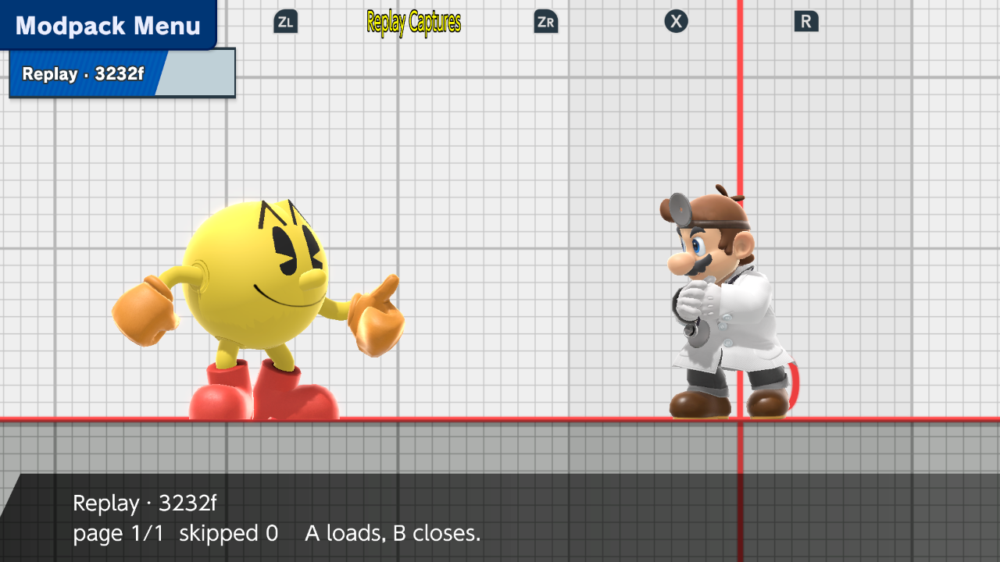

*Revision27: the saved Shulk/Pikachu match appears as “Replay · 3232f” after a
complete process restart with capture disabled. Pac-Man and Dr. Mario are the
current Training fighters at this picker screen; choosing the captured Pikachu
track subsequently requests the CPU change.*

4. Choose the captured fighter with **Up/Down**. After any CPU reload finishes,
   save a matching Training setup. Then follow the crop/preview/name controls below.

The native27 test selected Pikachu, previewed **[0,8)**, and saved **“R27 Pikachu
eight”**. All eight exported inputs matched the persisted capture's projection;
existing macro files were unchanged. A capture contains input/state observations,
not a complete simulation save state.

Companions are stored beneath `sd:/ultimate/TrainingModpack/replay_captures/` as
shared `.smd` bundles containing `manifest.json`, `timeline.jsonl` and a Training
`.tmrc` cache. Keep each bundle together. Canonical native floating-point values
are retained; Training's compact input rounding occurs in its cache/export.

Normal revision27 also passed a scoped emulator check with Deluxe `6c396f10` in
active manual LessLag mode: a saved 3,600-input capture reopened with capture off,
reloaded Pikachu, previewed **[0,8)**, and saved **“Deluxe Pikachu eight”** with exact
capture/export equality and the existing library preserved.

**Current limits:** capture is bounded and can be partial. Native-buffer completion
does not establish first/last simulation ticks or all sampling phases. Controlled
overhead and deliberate frame-drop tests are still pending, as are physical-Switch
and online checks. Capture is opt-in; no zero-cost claim is made.

## Existing saved replay → named macro (Vault fallback)

**Play the replay → return to Training → choose a fighter and frame window →
name and save → load the macro → restore your setup and play.**

### 1. Watch the saved replay

In Smash, open **Vault → Replays → Replay Data → Play**. Let it play through the
part you want to practice. The mod observes each fighter while the game runs its
native replay simulation.

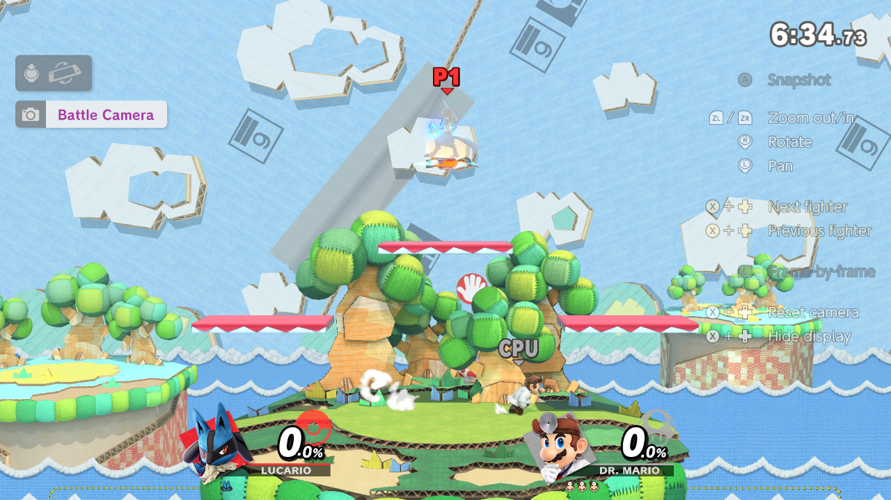

*The test replay is Lucario versus Dr. Mario on Yoshi's Story. Watching only part
of a replay gives you only that observed portion.*

End playback using the game's displayed quit combination, then enter Training
**without restarting the game**. The latest two observed captures stay in memory.
If Vault starts another loop, the preceding complete capture remains selectable.

**You do not need to watch the whole match.** Play through the end of the section
you want, then quit playback and enter Training. Only frames the game has actually
played are available to crop; include enough lead-in for an idle/fall start.

### 2. Open Input Recording

Open the modpack menu and go to **Input Recording**. **Replay Window** opens the
captured timelines; **Named Library** opens saved macros; **Edit Placement**
adjusts the loaded macro's starting position and momentum.

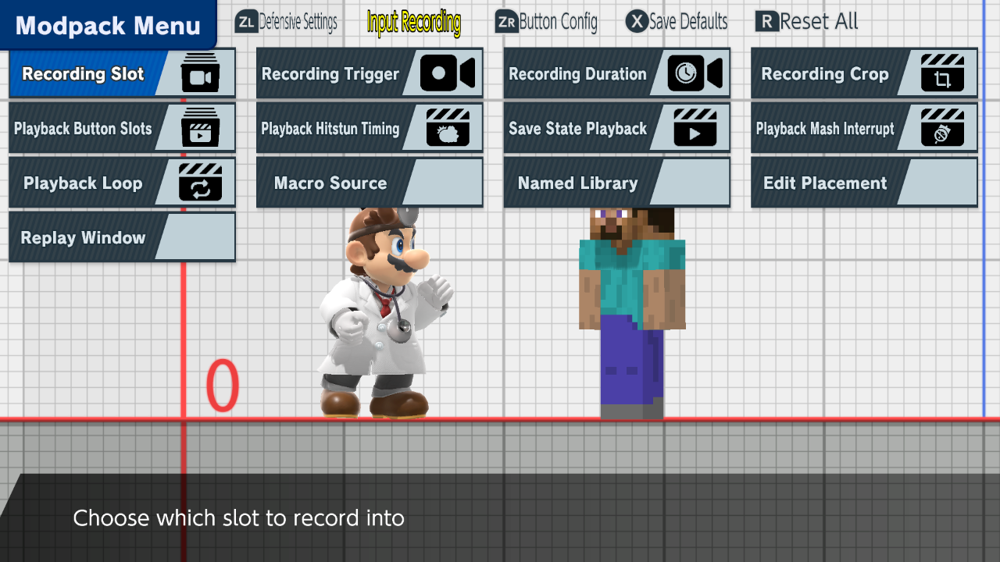

*The numbered recording workflow remains available through **Macro Source**.*

### 3. Choose the capture and fighter

Open **Replay Window** while the CPU is idle or falling. **D-pad Up/Down** changes
the selected fighter. **ZL+X** switches between the latest and previous capture when
both exist. On a GameCube controller, use **Z** for modifier combinations.

Before previewing, **enable save states and save a Training setup with both current
fighters**. After changing CPU kind, close the editor, save the new setup and reopen
Replay Window. A saved setup for different fighters is rejected without starting
input playback. Preview uses the explicitly selected slot, its original facing and
saved damage, independently of random-slot/mirroring/damage options.

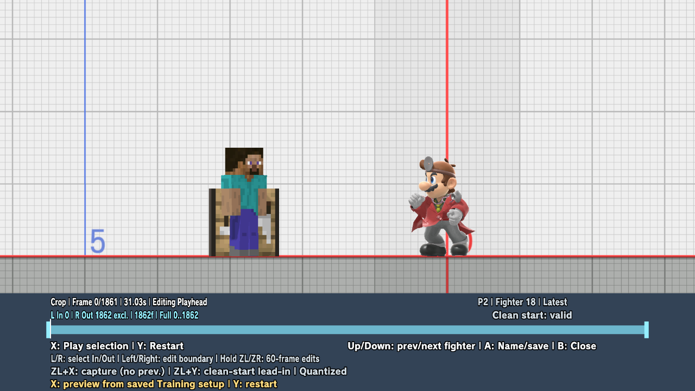

*Revision 21: P2 / fighter 18 selects Dr. Mario's 1,862 captured inputs. Steve is
the current Training P1. After Stop, both fighters have returned to the saved setup
and the marker is back at the selection's start.*

### 4. Select an exact frame window

**L** selects In and **R** selects Out. **D-pad Left/Right** edits that boundary.
The first steps are one frame, then 3, 8, 20, 45, 90, and 180 frames per tick as
the hold continues. Hold **ZL or ZR** (Z on a GameCube controller) to start at 20
frames per tick; the same curve still speeds up from there. A diagonal D-pad press
edits the end and does not change fighters. Handles cannot cross. An edit stops
any active preview and restores the saved setup; it does not move a fighter to a
recorded pose.

| Control | Native preview action |
| --- | --- |
| **X** | Play the selected range from the saved setup; while playing, Stop and restore. |
| **Y** | Restart the selected range from the saved setup. |
| **L / R**, then hold **D-pad Left / Right** | Choose an end and move it. The step speeds up while the direction is held. |
| **ZL or ZR** while moving | Start at 20 frames per tick and keep accelerating. On a GameCube controller, hold Z. |
| **B** | Close the editor and clean up preview. |

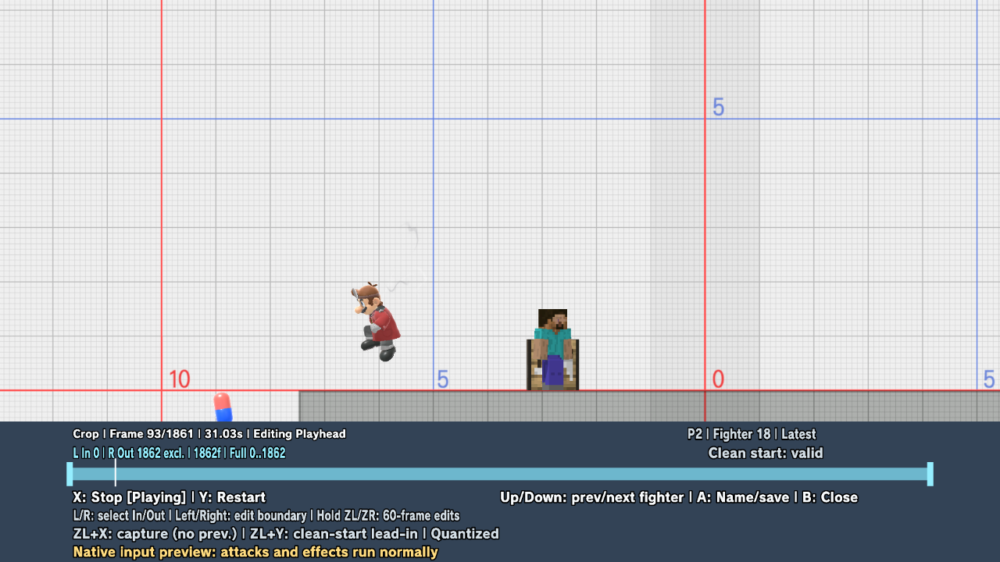

*The marker reports input 93 of the full selection during a restarted preview.
Dr. Mario and the capsule are running in the game's native simulation. Both
fighters can react; P1's controller remains owned by the editor.*

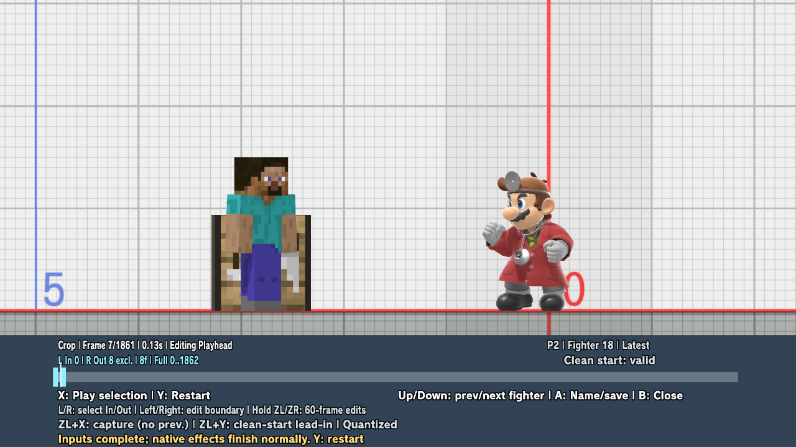

*This selection is **[0, 8)**: inputs 0–7, exactly eight inputs. Out is exclusive.
The marker stays at 7 after input completion while native animation/effects finish;
the fighters are not frozen at recorded poses.*

At the end of the range, injection stops and native attacks/effects continue under
neutral controls. Restart, edit or close to restore the setup. X can also start
another preview after completion. The marker advances with emitted inputs, not
draw callbacks. Duration labels assume 60 input frames per second; slow emulation
can take longer in real time. Pause, arbitrary seeking and frame-step are not offered.

Choose an idle/fall starting point. **ZL+Y** explicitly extends the
lead-in to a supported clean start. Starting partway through an arbitrary animation is
not supported. The editor reports analog rounding when CPU AI values fall between
controller steps. Use a suitable airborne saved setup for aerial starts. Preview's
temporary input sequence does not replace the loaded library entry or change the
loop/record/playback-on-load settings.

### 5. Name and save the export

Press **A: Name/save** to open the native system keyboard. Enter a name and confirm
using the keyboard's displayed controls. Cancelling or entering an invalid name
retains the crop/draft so you can retry. Check the fighter and frame count first.

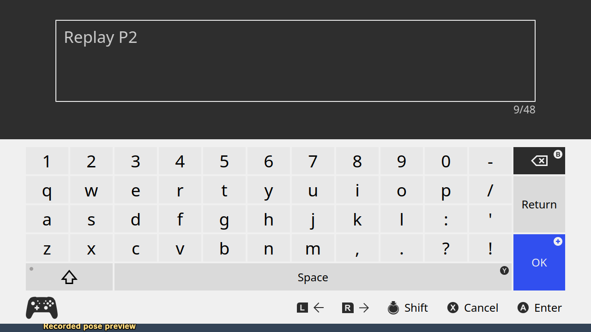

*Native keyboard from the revision 13 eight-frame export test, before confirmation.
It is a separate test moment from the revision 21 crop above. Follow the keyboard's
own cancel/confirm labels; they differ from the editor's B-to-close control.*

Exported macros persist in `sd:/ultimate/TrainingModpack/macros/`. Unsaved Vault
capture timelines disappear when the game exits; live companions saved through the
optional route above persist separately. The library is not limited to five slots;
named recording/capture has a ten-minute gameplay-frame safety bound.

### 6. Load the macro and play it

Open **Named Library** and select the saved entry. Loading requests the macro's
CPU fighter; close the menu and let the character change finish. Existing
supported-fighter restrictions still apply.

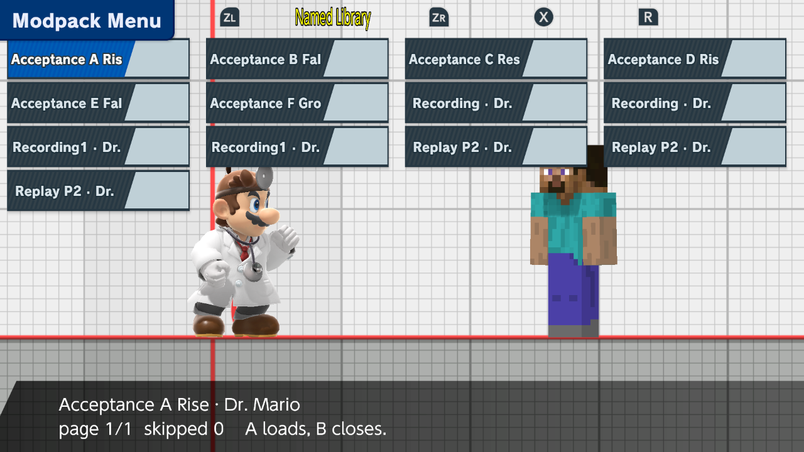

*The "Replay P2" entries are saved exports. "Acceptance A–F" are synthetic test
fixtures used during verification, rather than additional user recordings.*

Enable save states and save the Training setup you want to practice. Use your
configured **Input Playback** combination: the setup restores, the macro start
is prepared, and its inputs begin. The CPU's saved position is the reference for
placement.

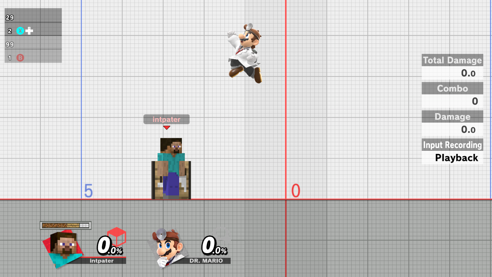

*The Training HUD shows **Input Recording: Playback**. Steve is now P1 and Dr.
Mario is the CPU; the exported inputs belong to the replay's Dr. Mario. This
single image shows playback in progress, not a completion count.*

### 7. Adjust placement and starting momentum

After loading a macro and restoring a Training state, open **Edit Placement**.
The crosshair previews the target without moving the real CPU while you edit.
**X− / X+ / Y− / Y+** move by one world unit; lowercase controls move by a quarter.

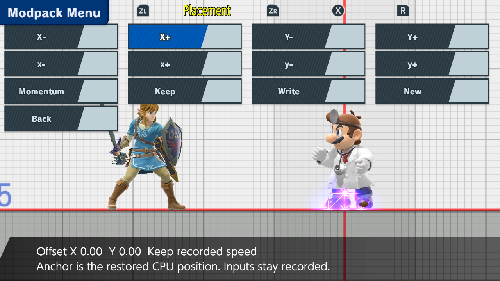

*Placement controls from an earlier build, with Link as P1. This image shows zero
offset and **Keep recorded speed**; it does not show a displaced target crosshair.*

| Action | Result |
| --- | --- |
| **Keep** | Apply the edit in memory. |
| **Write** | Overwrite this macro's placement metadata. |
| **New** | Open naming and save a separate macro. |
| **Back** | Cancel the edit. |
| **Momentum** | Choose **Keep recorded speed** or **Start at rest**. |

Offsets are relative to the **CPU's restored Training position**, rather than
its original replay coordinates or its later live position. Repeated playback
uses the same restored reference, so offsets do not accumulate. Placement edits
keep the recorded input sequence intact.

Recorded speed is applied just before input zero, after restoration. Horizontal
speed and inputs follow facing mirroring. **Start at rest** clears initial
velocity; normal gravity and physics then resume. For an aerial drill, save an
airborne setup or raise the placement enough to avoid landing before playback
starts. An unsupported start stops before consuming input zero and asks you to
adjust the setup.

## Record your own CPU drill

1. Set **Input Recording → Macro Source → Named Library**.
2. Use your configured **Input Record** combination to possess and control the CPU.
3. Press the same combination again to finish; the stop command is excluded.
4. Review the fighter, duration and frame count in **Save Recording**, enter a
   name and save. **Recording Crop** can trim trailing neutral input.
5. Load, place and play the recording using the same library workflow above.

**Y** on the Save Recording panel opens placement controls. **A: Name and save**
opens the system keyboard. Recording/playback button combinations are configurable,
so use the ones assigned in your setup.

## Changing preview fighters and closing the editor

Changing fighter kind parks the crop while the CPU reloads. P1 remains held and
jump/Plus input is consumed. The percent HUD and native Training statistics remain
hidden until the editor closes. The new CPU settles to grounded idle before the
editor returns. Use an idle CPU behavior for this switching workflow, then save a
matching setup before playing the newly selected fighter's inputs.

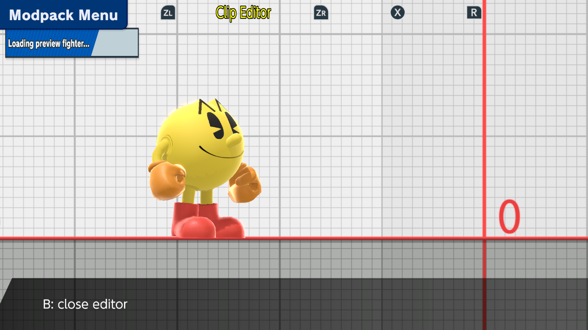

**B closes the editor during loading; an already-started native character install
finishes safely.** Stop, Restart and close use the native death/rebirth save-state
cleanup. They restore the saved Training baseline for both fighters, not the world
that happened to be present when the editor opened. Normal controls and native
Training menus become available after cleanup. If restoration stalls, B closes the
editor and native Plus can exit Training; stalled cleanup is not reported as success.

## What has been tested

### Revision 21: native preview

- A saved setup with mismatched fighters was rejected before any preview injection.
- With a matching Steve / Dr. Mario setup, all **1,862 selected inputs** completed.
  Native attacks, a visible capsule, hit interactions and effects were observed.
- **Y Restart** restored the setup and began at input zero; **X Stop** after
  424 inputs restored both saved anchors.
- Two **[0, 8)** runs each emitted exactly eight inputs and ended at marker 7.
- A **1.5-second held B** closed and restored without leaking a special into
  gameplay. Native Plus then opened the menu and Quit Training returned to CSS.
- Legacy macro source with loop, record-on-load and playback-on-load enabled did
  not hijack preview, and the settings file remained unchanged.
- All emitted indices were contiguous. Native getter observations covered every
  write with matching buttons and raw/deadzoned main-stick values. The full run had
  1,865 observations for 1,862 writes; the interrupted restart had 427 for 424.
  Repeated observations are not proof of one callback per gameplay tick.
- **21 panel tests**, strict host/native all-target Clippy and no-default builds
  passed. The runtime exited normally; the test clone was restored and the original
  profile's recorded comparison set was unchanged.

These runtime checks used the diagnostic build. The normal build passed its build
checks and has the same 111 source fingerprints, but is a different binary.

### Earlier recording, library and lifecycle checks

- Native replay observation, switching between latest and preceding captures,
  fighter selection and exact input-window export.
- A full 1,862-frame P2 export completing playback, plus an exact **[0, 8)** export
  equal to that full export's first eight inputs.
- Eight-frame button/left-stick delivery, including mirrored playback, and a
  later 120-frame exact writer/native-getter comparison passed. A full 1,862-frame
  trace wrote each input exactly once in order, with matching native getter values;
  the observer repeated one sequence three extra times, so strict one-observation-
  per-gameplay-tick timing remains unproven.
- Manual recording, persistent library operations, placement edits/Save As,
  nonaccumulating restores, and Dr. Mario rising/falling/at-rest momentum checks.
- A 143-frame manual recording with native-keyboard cancellation, invalid-name
  rejection, retry/save and library selection without automatic playback.
- Revision 17 tested the earlier recorded-pose crop backend. Its frame-seeking and
  presentation-driven preview controls have been replaced by the native controls above.
- Y/Plus blocked during native loading; the revision 17 short B-cancel case,
  grounded fighter acquisition and standard HUD/statistics hiding passed.
- A native non-ready CPU reached the 600-callback loading timeout: the editor returned
  with the selection preserved and the expected notification.
- The old pose-preview lifecycle reacquired its original CPU anchor after close.
  Closed-editor Training leave/reentry retained the in-memory capture.
- Revision 20 fixed the closing-button leak: six 120 ms closes and holds of
  300 ms, 1.5 seconds and 3 seconds stayed neutral. A fresh B press after release
  still worked; a 1.5-second loading cancel also finished safely. These checks used
  King Dedede with Dr. Mario/Lucario on the default single-controller setup.
- Strict native all-target Clippy and release/no-default builds passed. Test
  profiles were restored and the original profile's fingerprints remained unchanged.

## Remaining qualification work

| Item | Current evidence / remaining work |
| --- | --- |
| Post-close input | Revision 21 passed a 1.5-second held close and native-menu exit. Revision 20 separately covered short/three-second holds, fresh-press recovery and loading cancellation. Broader controller mappings remain unverified. |
| Reload failure / scene changes | Earlier character-loading timeout preserved the selection. Revision 21's separate failed-restore recovery route was source-reviewed, but a stalled restore was not deliberately induced. Open/busy departure and deliberate non-idle CPU cases remain unqualified. |
| Fighter and effect coverage | Native Dr. Mario attacks/capsule and settling were observed. Broader airborne setups, other fighters/partners and complete article cleanup remain unqualified. Restoring a saved Training baseline is not arbitrary simulation rewind. |
| Input timing and controls | Traces cover every emitted input and its native getter values. Repeated callbacks do not establish universal gameplay-tick timing. General C-stick/remapping remains unqualified; native review identifies the upstream “right-stick” fields as rumble state. |
| Library-selection combinations | Temporary preview ownership is source-reviewed. The revision 21 runtime stressed legacy source and automatic actions; it did not exercise a separate preloaded named-library selection matrix. |
| Performance | Emulator frame rate varied. This is not a real-time 60 FPS guarantee. |
| Physical Switch | Local emulator acceptance does not establish hardware validation. |

Revision 21 received independent source review, including a correction to stalled
restore recovery. Earlier independent reviews covered native controls and lifecycle
behavior. Runtime claims above come from the actual exercised cases.

This feature supplies
one fighter's inputs from your chosen Training setup; it does not reconstruct
the original match's other fighter, RNG, or arbitrary animation/simulation state.

### Can I import the replay file without playing it?

Direct file import is not integrated, but **a raw file decoder already exists**.
It reads the researched human-controller packets. The replay format contains
controller records rather than a per-frame dump of simulated CPU actions and
rendered poses. In the researched Lucario-versus-CPU replay, only the human's
controller slot contains packets even though the CPU performs many actions.
Those CPU-generated inputs become observable when the game runs its simulation.

The remaining adapter needs a generally verified mapping from file records to
gameplay frames, fighter/controller ownership and the macro's control stream.
Native input preview does not require recorded poses. Human inputs imported from
a file could still drive a Training CPU. Treating absent original-AI controller
packets as neutral input or guessing frame timing would produce an incorrect macro.
For now, play through only the part you need, then use the captured timeline.
The latest/previous in-memory captures can be cropped repeatedly without replaying
that same material while the game remains open.

## About the screenshots

These screenshots come from native acceptance runs on October 10–11, with emulator
menu/status chrome cropped away. They are not one continuous session. The visual
editor/preview images are revision 21; the loading example is revision 17 and the
system keyboard is revision 13. Replay/library/playback and placement examples are
earlier runs. Historical numeric-editor, pose-preview and custom-keyboard images
remain in the provenance archive but are no longer the current instructions.
Game pixels are unaltered.
See [screenshot provenance](SCREENSHOTS.md) for sources and crop details.
