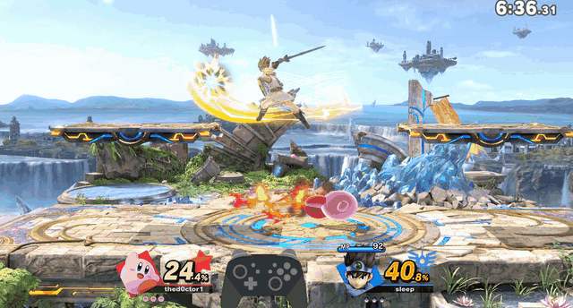
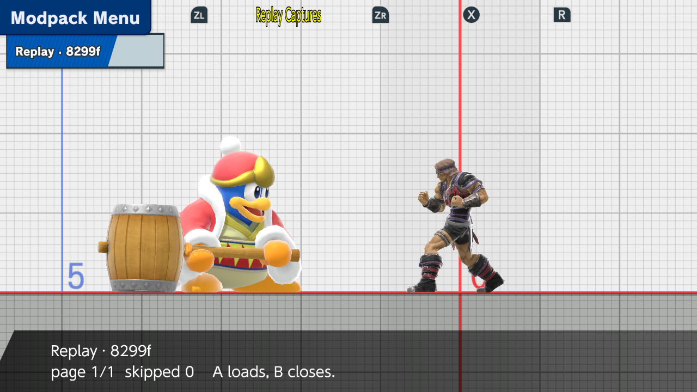
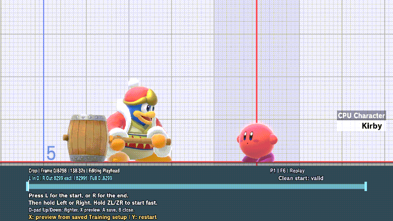
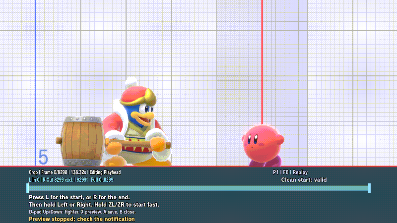
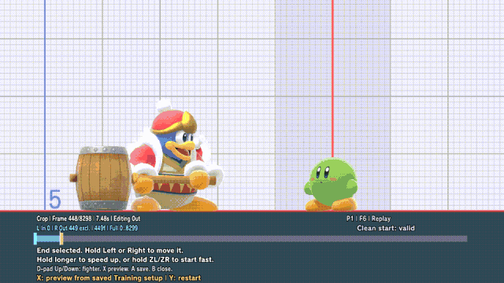
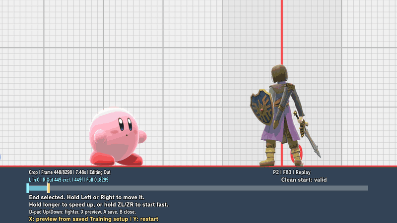
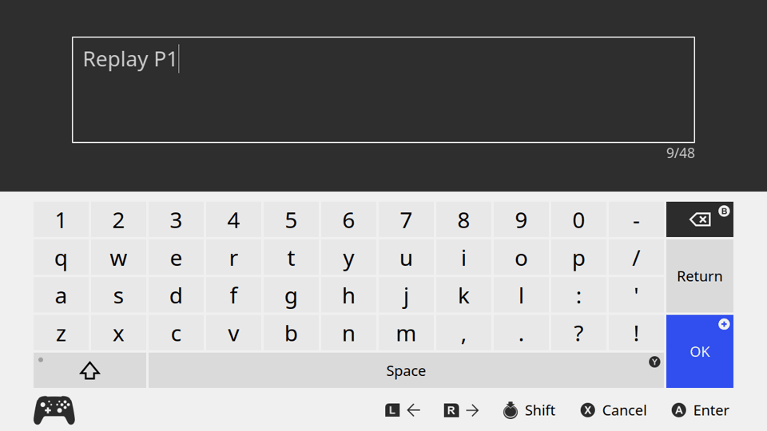

# Named CPU macros

Save a match, open it in Training, choose a captured player, crop the part you want, and play those inputs on the CPU. Choose your opponent to practice against their inputs.

Before the match, turn on capture in `sd:/ultimate/TrainingModpack/replay_capture.ini`:

```ini
[capture]
enabled=on
```

## The match

Kirby is our player (P1); Hero is the opponent (P2) in this saved match. This is the opening segment used in both playback examples below.



## Where it was saved

After the game's **Save Replay**, open **Input Recording → Replay Window** in Training to see **Replay Captures**. This one is **Replay · 8299f**: the replay name and its length in frames. Press **A** to open it.



The companion is written only after Save Replay succeeds. Later Training sessions can open it even with capture turned off.

## Choose the fighter

**D-pad Up/Down** switch between the captured players. The CPU changes to match their fighter. **P1 / Kirby** is our player in this match; **P2 / Hero** is the opponent. P1/P2 here identify players in the saved match, not the current Training controller. Either player's inputs can run on the Training CPU.



## Move the crop

Press **L** for the start or **R** for the end, then hold **Left** or **Right**. The step grows the longer that direction is held. Hold **ZL** or **ZR** to start already fast. A diagonal press keeps moving the selected end. Sticks do not change the fighter.

If the editor says **Needs ZL+Y lead-in**, press **ZL+Y** to include the preceding clean start.



## Play it back

Wait until the captured fighter has finished loading, close the editor, and save a Training setup with **ZL+Down**. A setup saved for a different CPU will not preview. Reopen the capture, set the crop, and press **X**. The CPU runs those inputs from your saved setup; **Y** restarts the preview.

Both examples use **In 0 / Out 449**: the first 449 captured input frames. They cover the match opening above, but play from a Training setup, so positions, hits, and timing can differ.

Here the Training CPU plays **P1 / Kirby's inputs**. King Dedede is the current Training player.



To practice against the opponent instead, select **P2 / Hero**, wait for Hero to load, and save a new Training setup before previewing.



## Name and keep it

**A** opens the keyboard. The suggested name is the replay name plus the captured player, such as **Replay P1** or **Replay P2**. Enter a name, then press **Plus** to save it. This example saves Kirby's P1 inputs.



Find it under **Input Recording → Named Library**. **A** loads it. Close the menu before using your configured playback shortcut; the default is **ZR + D-pad Up**. Playback runs the inputs on the CPU in your current Training setup, so the result can differ from the original match.

The file format and the rest of the controls are in [Named CPU macros](../named-macros.md).
