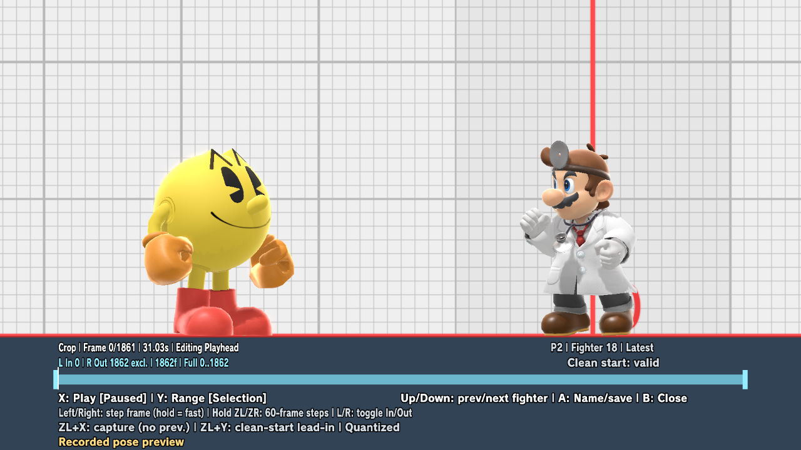
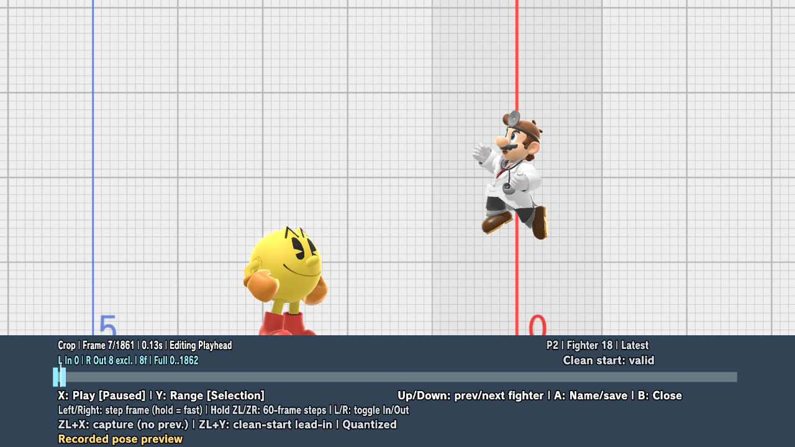

# Named CPU macros: a screenshot walkthrough

Turn one fighter's replay inputs into a reusable Training drill, or record a new
drill by controlling the CPU. Give it a name, load it from the library, and play
it from your saved Training setup with adjustable position and starting momentum.

**Development preview · Updated October 11, 2026, through revision 17.** These are real captures from native
game tests of the local implementation. This documentation branch publishes the
walkthrough; the macro implementation is still undergoing acceptance testing and
has not been released or deployed to a physical Switch.

## Implemented features

- **Named CPU recording:** possess the CPU, record up to ten minutes, optionally
  trim trailing neutral input, and save reusable drills without a five-slot limit.
- **Persistent library:** browse/load recordings, request their CPU fighter, and
  remember the selected recording across restarts.
- **Native naming keyboard:** confirm a name to save; cancel or invalid-name
  validation keeps the draft available for another attempt.
- **Replay capture:** retain the latest and previous observed captures in memory,
  select one fighter, and export an exact input window.
- **Visual crop editor:** recorded-pose preview, separate playhead/In/Out handles,
  single-frame and accelerated seeking, 60-frame jumps, and selected/full playback.
- **Placement and playback:** restore a Training setup, apply relative whole- or
  quarter-unit offsets, preserve recorded momentum or start at rest, and mirror
  horizontal inputs/momentum with facing. Temporary edits, overwrite and Save As
  are available.
- **Preview lifecycle:** grounded acquisition after character loading, P1 input
  isolation, standard HUD/statistics hiding, cancellation and CPU-anchor restoration.

## Saved replay → named macro

**Play the replay → return to Training → choose a fighter and frame window →
name and save → load the macro → restore your setup and play.**

### 1. Watch the saved replay

In Smash, open **Vault → Replays → Replay Data → Play**. Let it play through the
part you want to practice. The mod observes each fighter while the game runs its
native replay simulation.

*The test replay is Lucario versus Dr. Mario on Yoshi's Story. Watching only part
of a replay gives you only that observed portion.*

End playback using the game's displayed quit combination, then enter Training
**without restarting the game**. The latest two observed captures stay in memory.
If Vault starts another loop, the preceding complete capture remains selectable.

### 2. Open Input Recording

Open the modpack menu and go to **Input Recording**. **Replay Window** opens the
captured timelines; **Named Library** opens saved macros; **Edit Placement**
adjusts the loaded macro's starting position and momentum.

*The numbered recording workflow remains available through **Macro Source**.*

### 3. Choose the capture and fighter

Open **Replay Window** while the CPU is idle or falling. **Up/Down** changes the
selected fighter. **ZL+X** switches between the latest and previous capture when
both exist. On a GameCube controller, use **Z** for modifier combinations.

*Revision 17: P2 / fighter 18 is Dr. Mario. This latest capture contains 1,862 frames.
The visible CPU previews Dr. Mario's recorded poses; P1 Pac-Man is held in place.
Exporting P2 selects Dr. Mario's inputs.*

### 4. Select an exact frame window

**Left/Right** seeks one frame; holding accelerates. Hold **ZL or ZR** while
seeking for 60-frame steps. **L** selects the In handle and **R** selects Out;
press the same handle button again to return to the playhead. Handles cannot cross.

*This selection is **[0, 8)**: frames 0–7, exactly eight inputs. Out is exclusive;
its preview is the last included frame, 7. The CPU's airborne pose is from that
recorded frame, not newly simulated from injected replay inputs.*

**X** plays/pauses from the current playhead. **Y** selects cropped or full-capture
playback. At the finished endpoint, X restarts the chosen range. Playback stops at
the last included frame. Frame labels use 60 gameplay frames per second; preview
advancement follows presentation and can be slower on a slow emulator.

Choose an idle/fall starting point. **ZL+Y** explicitly extends the
lead-in to a supported clean start. Starting partway through an arbitrary animation is
not supported. The editor reports analog rounding when CPU AI values fall between
controller steps.

### 5. Name and save the export

Press **A: Name/save** to open the native system keyboard. Enter a name and confirm
using the keyboard's displayed controls. Cancelling or entering an invalid name
retains the crop/draft so you can retry. Check the fighter and frame count first.

*Native keyboard from the revision 13 eight-frame export test, before confirmation.
It is a separate test moment from the revision 17 crop above. Follow the keyboard's
own cancel/confirm labels; they differ from the editor's B-to-close control.*

Exported macros persist in `sd:/ultimate/TrainingModpack/macros/`. Unsaved capture
timelines disappear when the game exits. The library is not limited to five slots;
named recording/capture has a ten-minute gameplay-frame safety bound.

### 6. Load the macro and play it

Open **Named Library** and select the saved entry. Loading requests the macro's
CPU fighter; close the menu and let the character change finish. Existing
supported-fighter restrictions still apply.

*The "Replay P2" entries are saved exports. "Acceptance A–F" are synthetic test
fixtures used during verification, rather than additional user recordings.*

Enable save states and save the Training setup you want to practice. Use your
configured **Input Playback** combination: the setup restores, the macro start
is prepared, and its inputs begin. The CPU's saved position is the reference for
placement.

*The Training HUD shows **Input Recording: Playback**. Steve is now P1 and Dr.
Mario is the CPU; the exported inputs belong to the replay's Dr. Mario. This
single image shows playback in progress, not a completion count.*

### 7. Adjust placement and starting momentum

After loading a macro and restoring a Training state, open **Edit Placement**.
The crosshair previews the target without moving the real CPU while you edit.
**X− / X+ / Y− / Y+** move by one world unit; lowercase controls move by a quarter.

*Placement controls from an earlier build, with Link as P1. This image shows zero
offset and **Keep recorded speed**; it does not show a displaced target crosshair.*

| Action | Result |
| --- | --- |
| **Keep** | Apply the edit in memory. |
| **Write** | Overwrite this macro's placement metadata. |
| **New** | Open naming and save a separate macro. |
| **Back** | Cancel the edit. |
| **Momentum** | Choose **Keep recorded speed** or **Start at rest**. |

Offsets are relative to the **CPU's restored Training position**, rather than
its original replay coordinates or its later live position. Repeated playback
uses the same restored reference, so offsets do not accumulate. Placement edits
keep the recorded input sequence intact.

Recorded speed is applied just before input zero, after restoration. Horizontal
speed and inputs follow facing mirroring. **Start at rest** clears initial
velocity; normal gravity and physics then resume. For an aerial drill, save an
airborne setup or raise the placement enough to avoid landing before playback
starts. An unsupported start stops before consuming input zero and asks you to
adjust the setup.

## Record your own CPU drill

1. Set **Input Recording → Macro Source → Named Library**.
2. Use your configured **Input Record** combination to possess and control the CPU.
3. Press the same combination again to finish; the stop command is excluded.
4. Review the fighter, duration and frame count in **Save Recording**, enter a
   name and save. **Recording Crop** can trim trailing neutral input.
5. Load, place and play the recording using the same library workflow above.

**Y** on the Save Recording panel opens placement controls. **A: Name and save**
opens the system keyboard. Recording/playback button combinations are configurable,
so use the ones assigned in your setup.

## Changing preview fighters and closing the editor

Changing fighter kind parks the crop while the CPU reloads. P1 remains held and
jump/Plus input is consumed. The percent HUD and native Training statistics remain
hidden until the editor closes. The new CPU settles to grounded idle before preview
resumes. Use an idle CPU behavior for this switching workflow.

**B closes the editor during loading; an already-started native character install
finishes safely.** Closing after preview restores the CPU's Training anchor, facing
and clean idle/fall state. Normal controls and native Training menus become available
again. This does not restore an arbitrary internal action or the entire replay match.

## What has been tested

- Native replay observation, switching between latest and preceding captures,
  fighter selection, and exact frame seeking.
- A full 1,862-frame P2 export completing playback, plus an exact **[0, 8)** export
  equal to that full export's first eight inputs.
- All eight observed button/left-stick samples delivered in order in the short
  test, including mirrored playback; the full run has first-eight detailed
  observations and a full-length completion count.
- Manual recording, persistent library operations, placement edits/Save As,
  nonaccumulating restores, and Dr. Mario rising/falling/at-rest momentum checks.
- A 143-frame manual recording with native-keyboard cancellation, invalid-name
  rejection, retry/save and library selection without automatic playback.
- Revision 17 visual crop **[0, 8)** endpoint/restart and full **0…1861** preview.
- Y/Plus blocked during native loading; B cancellation without triggering P1's
  special; grounded fighter acquisition and standard HUD/statistics hiding.
- The same CPU reacquired its original anchor 33.8 seconds after a full-preview
  close. Closed-editor Training leave/reentry retained the in-memory capture.
- Strict native all-target Clippy and release/no-default builds passed. Test
  profiles were restored and the original profile's fingerprints remained unchanged.

## Remaining qualification work

| Item | Current evidence / remaining work |
| --- | --- |
| Post-close frame advantage | Two small values, −7/−4, appeared after closing. None occurred inside preview leases; their cause remains under investigation. |
| Reload failure / scene changes | The 600-tick timeout and departure with an open/busy editor still need targeted coverage. Normal cancellation and closed-editor leave/reentry passed. |
| Airborne and visual fidelity | Broader airborne anchors, secondary motion, articles/effects, fighter coverage and exact presentation timing remain qualified. |
| Exported playback coverage | Full completion and a detailed eight-frame comparison passed; longer-window exact-once, in-order input delivery and nonzero secondary-stick coverage remain open. Full original-match trajectory reconstruction is outside the design. |
| Physical Switch | Local emulator acceptance does not establish hardware validation. |

The follow-up assignments are Opus 5.5 **xhigh** for post-close accounting/root-cause
review; Fable 5.1 **high** for timeout, scene-change and airborne lifecycle checks;
and Grok 4.7 **xhigh** for fidelity/playback coverage and physical-test feasibility.
Assignments are work in progress, not additional passing results.

This feature supplies
one fighter's inputs from your chosen Training setup; it does not reconstruct
the original match's other fighter, RNG, or arbitrary animation/simulation state.

## About the screenshots

These screenshots come from native acceptance runs on October 10–11, with emulator
menu/status chrome cropped away. They are not one continuous session. The visual
editor/loading images are revision 17; the system keyboard is revision 13; the
replay/library/playback and placement examples are earlier runs. Historical numeric
editor/custom-keyboard images remain in the provenance archive but are no longer
the current instructions. Game pixels are unaltered.
See [screenshot provenance](SCREENSHOTS.md) for sources and crop details.
