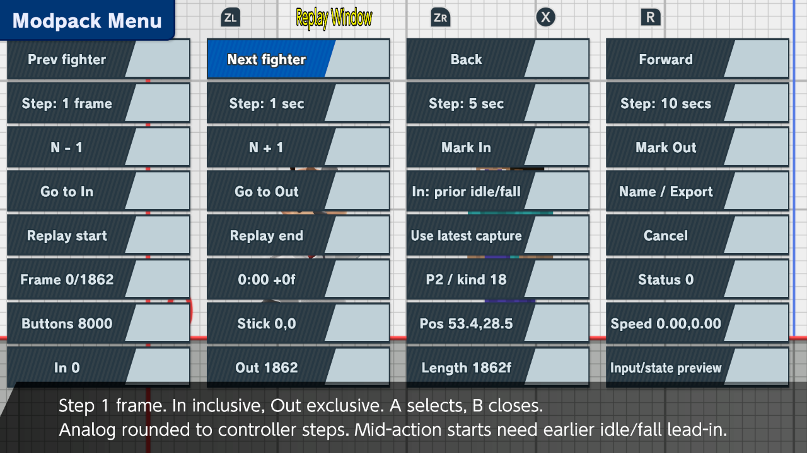
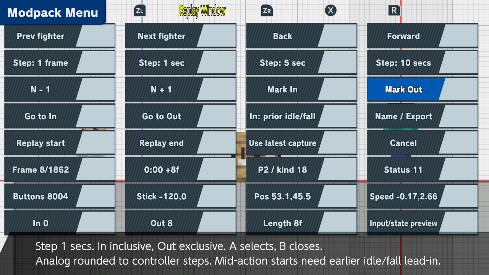
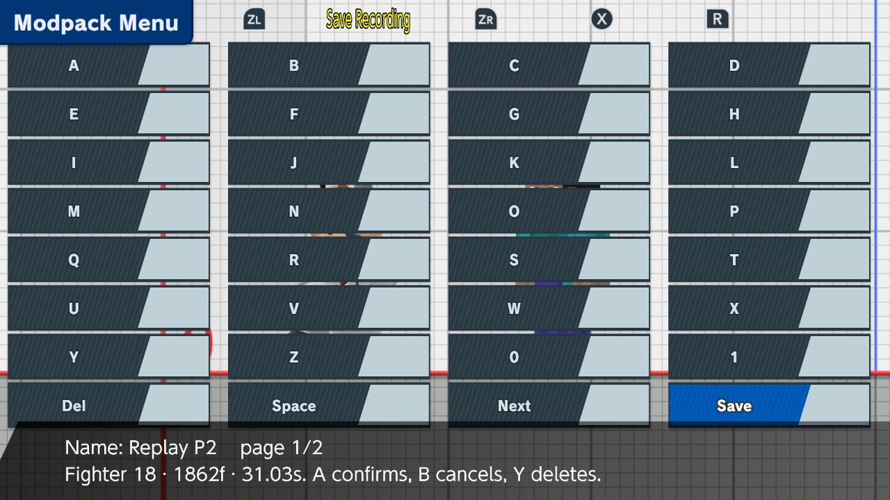

# Named CPU macros: a screenshot walkthrough

Turn one fighter's replay inputs into a reusable Training drill, or record a new
drill by controlling the CPU. Give it a name, load it from the library, and play
it from your saved Training setup with adjustable position and starting momentum.

**Development preview · October 10, 2026.** These are real captures from native
game tests of the local implementation. This documentation branch publishes the
walkthrough; the macro implementation is still undergoing acceptance testing and
has not been released or deployed to a physical Switch.

## Saved replay → named macro

**Play the replay → return to Training → choose a fighter and frame window →
name and save → load the macro → restore your setup and play.**

### 1. Watch the saved replay

In Smash, open **Vault → Replays → Replay Data → Play**. Let it play through the
part you want to practice. The mod observes each fighter while the game runs its
native replay simulation.

*The test replay is Lucario versus Dr. Mario on Yoshi's Story. Watching only part
of a replay gives you only that observed portion.*

End playback using the game's displayed quit combination, then enter Training
**without restarting the game**. The latest two observed captures stay in memory.
If Vault starts another loop, the preceding complete capture remains selectable.

### 2. Open Input Recording

Open the modpack menu and go to **Input Recording**. **Replay Window** opens the
captured timelines; **Named Library** opens saved macros; **Edit Placement**
adjusts the loaded macro's starting position and momentum.

*The numbered recording workflow remains available through **Macro Source**.*

### 3. Choose the capture and fighter

In **Replay Window**, use **Prev fighter / Next fighter** to select whose inputs
to export. Use **Use previous capture / Use latest capture** when needed. The
button names the capture you can switch **to**, not the one currently displayed.

*Here P2 / kind 18 is Dr. Mario. The complete preceding capture contains 1,862
frames; the newer partial loop contained 1,641. Exporting P2 selects Dr. Mario's
inputs; Lucario's actions are not included.*

### 4. Select an exact frame window

Choose **Step: 1 frame**, **1 sec**, **5 sec**, or configurable **N secs**, then
use **Back / Forward**. Seconds mean 60 gameplay frames, regardless of emulator
speed. **Mark In** and **Mark Out** define the exported range.

*This selection is **[0, 8)**: frames 0–7, exactly eight inputs. Out is exclusive.
The cursor's displayed input/state is a preview; it does not rewind the live game.*

Choose an idle/fall starting point. **In: prior idle/fall** explicitly extends the
lead-in to a supported start. Starting partway through an arbitrary animation is
not supported. The editor reports analog rounding when CPU AI values fall between
controller steps.

### 5. Name and save the export

Select **Name / Export**. In **Save Recording**, use the D-pad and A to enter a
name, **Next** for the second keyboard page, Y to delete, **Save** to write, or B
to cancel. Check the fighter and frame count before saving.

*This naming screenshot is the separate **full 1,862-frame export**, not the
eight-frame selection above. Both use the same naming and save flow.*

Exported macros persist in `sd:/ultimate/TrainingModpack/macros/`. Unsaved capture
timelines disappear when the game exits. The library is not limited to five slots;
named recording/capture has a ten-minute gameplay-frame safety bound.

### 6. Load the macro and play it

Open **Named Library** and select the saved entry. Loading requests the macro's
CPU fighter; close the menu and let the character change finish. Existing
supported-fighter restrictions still apply.

*The "Replay P2" entries are saved exports. "Acceptance A–F" are synthetic test
fixtures used during verification, rather than additional user recordings.*

Enable save states and save the Training setup you want to practice. Use your
configured **Input Playback** combination: the setup restores, the macro start
is prepared, and its inputs begin. The CPU's saved position is the reference for
placement.

*The Training HUD shows **Input Recording: Playback**. Steve is now P1 and Dr.
Mario is the CPU; the exported inputs belong to the replay's Dr. Mario. This
single image shows playback in progress, not a completion count.*

### 7. Adjust placement and starting momentum

After loading a macro and restoring a Training state, open **Edit Placement**.
The crosshair previews the target without moving the real CPU while you edit.
**X− / X+ / Y− / Y+** move by one world unit; lowercase controls move by a quarter.

*Placement controls from an earlier build, with Link as P1. This image shows zero
offset and **Keep recorded speed**; it does not show a displaced target crosshair.*

| Action | Result |
| --- | --- |
| **Keep** | Apply the edit in memory. |
| **Write** | Overwrite this macro's placement metadata. |
| **New** | Open naming and save a separate macro. |
| **Back** | Cancel the edit. |
| **Momentum** | Choose **Keep recorded speed** or **Start at rest**. |

Offsets are relative to the **CPU's restored Training position**, rather than
its original replay coordinates or its later live position. Repeated playback
uses the same restored reference, so offsets do not accumulate. Placement edits
keep the recorded input sequence intact.

Recorded speed is applied just before input zero, after restoration. Horizontal
speed and inputs follow facing mirroring. **Start at rest** clears initial
velocity; normal gravity and physics then resume. For an aerial drill, save an
airborne setup or raise the placement enough to avoid landing before playback
starts. An unsupported start stops before consuming input zero and asks you to
adjust the setup.

## Record your own CPU drill

1. Set **Input Recording → Macro Source → Named Library**.
2. Use your configured **Input Record** combination to possess and control the CPU.
3. Press the same combination again to finish; the stop command is excluded.
4. Review the fighter, duration and frame count in **Save Recording**, enter a
   name and save. **Recording Crop** can trim trailing neutral input.
5. Load, place and play the recording using the same library workflow above.

The naming panel's second page also provides placement controls. Button
combinations are configurable, so use the ones assigned in your setup.

## What this preview has demonstrated

- Native replay observation, switching between latest and preceding captures,
  fighter selection, and frame/second seeking.
- A full 1,862-frame P2 export completing playback, plus an exact **[0, 8)** export
  equal to that full export's first eight inputs.
- All eight observed button/left-stick samples delivered in order in the short
  test, including mirrored playback; the full run has first-eight detailed
  observations and a full-length completion count.
- Manual recording, persistent library operations, placement edits/Save As,
  nonaccumulating restores, and Dr. Mario rising/falling/at-rest momentum checks.

Longer-window per-input timing, nonzero secondary-stick coverage, AI rounding and
broader lifecycle regressions remain under qualification. This feature supplies
one fighter's inputs from your chosen Training setup; it does not reconstruct
the original match's other fighter, RNG, or arbitrary animation/simulation state.

## About the screenshots

These screenshots come from existing native acceptance runs, with emulator
menu/status chrome cropped away. They are not one continuous session: the
placement example comes from an earlier test, and the naming panel shows the
full export separately from the eight-frame crop. Game pixels are unaltered.
See [screenshot provenance](SCREENSHOTS.md) for sources and crop details.
