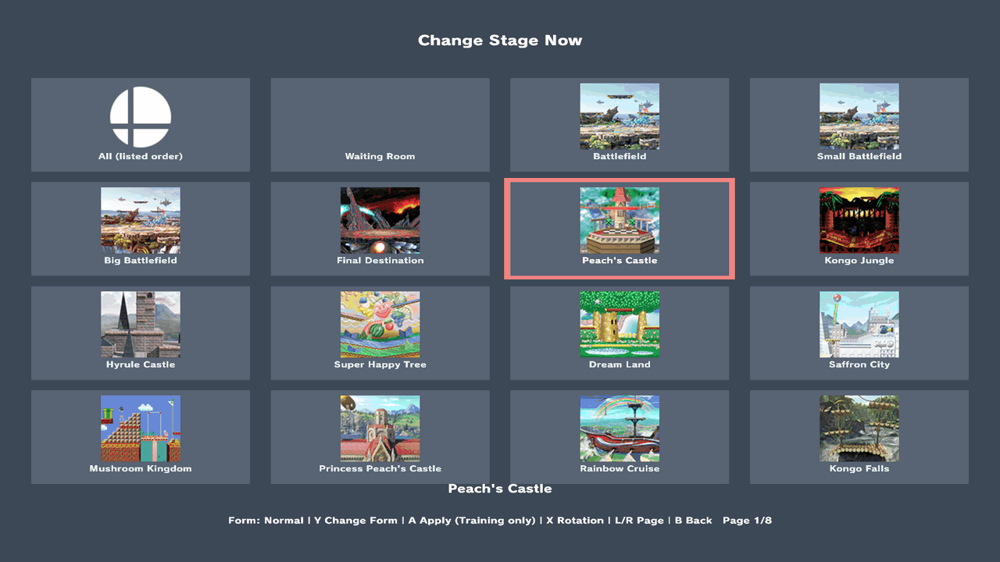
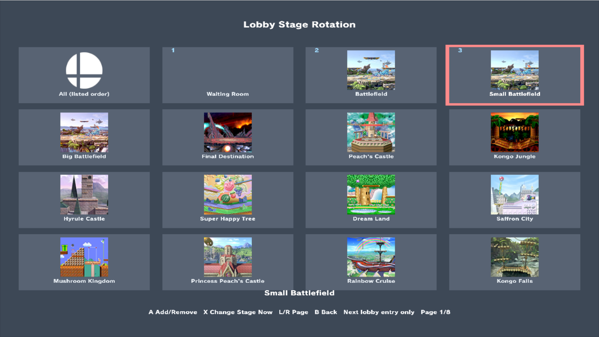

# Practice Stages

Change the stage you practice on without going back to character select, and choose which stages the waiting room rotates through. Part of the [enhancements alpha](experimental-release.md).

## Change the stage now

Open **Misc Settings → Practice Stages**. It opens at **Change Stage Now**: highlight a stage and press **A**. The menu closes and the stage changes. **L/R** turn the page, and the list also includes **Training** and **Waiting Room**.

*Peach’s Castle, Battlefield form. The full loading transition is kept. [Capture details](practice-stages/SCREENSHOTS.md).*

This works in Training and in lobby practice. In Training the new stage lasts for that session only. In a lobby, **A** also keeps the stage for your later lobby entries.

### Pick a form

Press **Y** on a named stage to cycle **Normal → Omega → Battlefield**; **A** applies the chosen form. The footer shows only the current choice, such as **Form: Omega**.

Unavailable forms are skipped. Stages with only one form have no **Y Change Form** hint.

Y never applies a stage or changes the rotation order. Change Stage Now and Lobby Stage Rotation keep their own forms.

## Rotate stages between lobby visits

Press **X** to open **Lobby Stage Rotation**, then press **A** on stages in the order you want to visit them. The rotation advances each time you enter lobby practice, including after a match. Ordinary Training follows it only while **Misc Settings → Training Stage Rotation** is On (default Off): each Training entry from character select takes the next stage. Press **X** again to return to Change Stage Now.

*Numbers show the order for future lobby entries. Editing this list does not change the current Training stage.*

If a lobby is keeping a stage you chose with **A**, open Lobby Stage Rotation before you close the menu to go back to rotating.

Lobby use needs **Misc Settings → Lobby Practice** turned on; see [Lobby Practice](lobby-practice.md). The online legal-stage pool and loser counterpick are in a separate plugin, [Stages + Counterpick](elite-counterpick.md).
