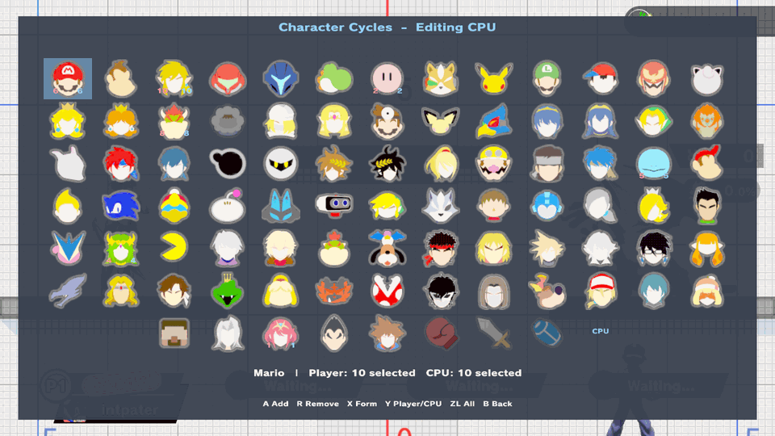

# Lobby Practice reference

Install, troubleshooting, lifecycle rules and test record behind the
[Lobby Practice guide](../lobby-practice.md). Controls are in the
[hot-swap guide](../fighter-hotswap.md), [Solo Popo](../solo-popo.md) and
[Practice Stages](../practice-stages.md); grid and cycle details are in the
[hot-swap reference](fighter-hotswap.md).

This is the [unstable enhancements alpha](../experimental-release.md) for Smash
Ultimate 13.0.5. Physical-Switch validation is pending.

Practice fighters change; the lower waiting card keeps the character selected
for the real match. [Controls and walkthrough](../lobby-practice.md).

## What changes where

A swap asks the game's own asynchronous fighter loader to refill one existing
practice entry per role. It adds no character-select slots or custom fighter IDs.
Player 1 and the CPU use the same mechanism with separate settings. Lobby
Practice needs a build with the `waiting-roster-reload` feature, as in the alpha
release; ordinary Training works without it. In the waiting room the menu is
titled **Lobby Practice**.

| Situation | Behavior |
| --- | --- |
| Waiting-room practice | P1 and CPU swap as in Training. The CPU's small icon updates (default-costume image) |
| The real match | Always uses your character-select pick. The lower waiting card shows that pick. CPU swaps only change the local practice dummy. Practice shortcuts and hooks are off |
| Back in the same lobby | Each role's last *completed* practice fighter returns once fresh waiting entries are ready. P1 needs **Player Swapping** On |
| A new lobby | Both remembered fighters are cleared. This is in-memory session state, not a saved character-select override |
| Ordinary Training | Keeps its own selections. Portrait and name update at once; native **L + R + A** reset keeps the current fighter |
| Training-only tools | Save/load (default **ZL + D-pad Down / Up**), recording/playback, native Training reset and some stage options. The waiting menu labels them |
| Stage rotation | Advances on the next lobby-practice entry, including after a match or a return through character select. Never rotates ordinary Training |

Restoration after a match waits for native dialogs, another load or pending
practice actions. A new explicit character request takes priority, and an
interrupted load never replaces the last completed choice. Lobby dialogs always
take input priority over practice.

## Swap safety

| Rule | Detail |
| --- | --- |
| Refused while busy | Save loading, recording/playback, native UI, another replacement or a pending training action. A notification reads **Character swap unavailable during this action** |
| Fresh start | A replacement clears per-session training state |
| Bound requests | Each request is tied to the observed entry identity and scene epoch |
| Teardown | Native destruction invalidates queued and active references before the original destructor runs. There is no manual loader pumping or forced cancellation |
| Save states | Restore position and damage onto the current fighter, not the saved fighter kind. Character-specific charge restores only for a matching kind |

## Install

1. Stop the game.
2. Replace the existing Training Modpack NRO. Never load two copies:

       sd:/atmosphere/contents/01006A800016E000/romfs/skyline/plugins/libtraining_modpack.nro

3. Keep `training_modpack_menu.conf`, saves, other plugins and emulator settings.
   This is a single-file update inside an existing Skyline installation.
4. Fully restart the game.

No separate `info_waiting.arc` is needed; an old copy is ignored. On each
waiting-room load, the NRO rebuilds the waiting UI from the game's loaded stock
archive, its embedded Training UI and a small compiled patch. Input and output
fingerprints must match before injection. The rebuilt archive is released about
five seconds after the game copies it.

**Downgrading:** existing ordered rosters and older fixed-slot selections migrate
when loaded. New saves write only ordered rosters, which earlier ordered-roster
builds can read. Earlier fixed-slot-only development builds cannot recover
edited rosters from the new file, so keep a backup of
`training_modpack_menu.conf` before going back to one.

## Troubleshooting

| Symptom | Check |
| --- | --- |
| No practice controls in the waiting room | **Misc Settings → Lobby Practice** must be On; leave and re-enter the practice area. Then look for `[LobbyPractice] embedded waiting UI disabled: …` in the log: a fingerprint mismatch keeps Lobby Practice inactive |
| Player 1 does not swap or return after a match | Turn on **Characters → Player Swapping** |
| A swap is refused | Another action owns practice; see [Swap safety](#swap-safety) and try again when idle |
| Save states or recording do nothing in the lobby | They need ordinary Training; the waiting menu labels them |
| Crash or freeze | Keep both logs below, any Atmosphère crash report, the exact NRO hashes, game version, fighter/costume choices and your last action |

Logs are `sd:/ultimate/TrainingModpack/practice-diagnostics.log` and
`practice-diagnostics.previous.log`: two rotating files of at most 128 KiB each.
They record build/version, scene, request/entry identity, loader phase,
completion, HUD/icon refresh, destruction, save/record events and Rust panics.
A native fault can prevent the final record.

## Rebuilding the waiting UI patch

The shipped patch is `src/static/waiting_ui.patch`: a bounded copy/literal
recipe, not a second full archive. Regenerate it only against a validated target,
when the embedded Training UI or the supported stock archive changes:

    python3 scripts/make_waiting_patch.py STOCK.arc src/static/layout.arc ACCEPTED-WAITING.arc src/static/waiting_ui.patch --report PATCH-REPORT.json

- The generator checks the reconstruction and records SHA-256 hashes.
  `scripts/waiting_patch_manifest.json` pins the accepted inputs and output;
  compare the new report before committing a regenerated patch.
- At runtime the NRO separately checks source lengths and fingerprints, copy
  ranges, maximum output size, and the exact output length and fingerprint.
- The private validation inputs stay outside the repository. Decoder unit tests
  use synthetic data; the private fixture check runs the real Rust decoder
  against the accepted archive.
- The development-only `layout_arc_from_file` feature affects ordinary Training
  only. The waiting rebuild always uses the pinned embedded donor.
- To rebuild the portrait-grid layout and this patch together, see the
  [roster grid builder](../../scripts/roster-grid/README.md).

## Test record

Emulator and local-wireless (LDN) checks passed for P1/CPU swaps, menus, the CPU
icon, the embedded waiting UI and a two-peer match/return. They do not establish
Nintendo online-service or ban safety; one controller per peer is the exercised
scope. Still required: physical-Switch repeated swaps, transitions, restarts and
vanilla-peer desync checks.

Results by build

| Build | Passed | Not repeated or not claimed |
| --- | --- | --- |
| Earlier native-reload build | P1/CPU reload, ordered/All menus, representative moves, save/record conflicts, reset and re-entry. Both LDN host roles against a vanilla peer: matching combat and results. Destroying the waiting CPU during an active Bayonetta load invalidated references; the match kept the original G&W pick | — |
| CPU-icon correction | Waiting portrait updates after a swap | — |
| Embedded waiting UI (external archive removed) | Training editor and P1/CPU swaps; waiting editor, swaps and CPU icon; LDN against a vanilla guest with original G&W, matching combat/results; a second waiting load reopened the editor (then from a cached UI; per-load since [revision 33](../REVISION33_STARTUP_MEMORY.md)). Rust decoder reproduced the accepted archive byte for byte. Three decoder tests, warning-free all-target NRO Clippy, no-default-features release build | Save/record and mid-load interruption (earlier regression checks only) |
| Same-lobby restore (earlier development build) | Two-peer LDN match/return and fresh-room reset | Online arenas, physical Switch |
| Enhancements development build, 2026-10-16 | Strict all-target Clippy, release and no-default builds; 150 host suite tests and 5 probes. Native Training and solo local-wireless Solo Popo, dual cycle orders, All, P1/CPU swaps, CPU form and CPU icon — see [development validation](../character-cycles-validation.md#enhancements-development-build--2026-10-16) | New two-peer match/return, online arenas, physical Switch |

## Implementation notes

Hardening, hooks, CPU icon and roster storage

- **CPU icon.** The waiting HUD resource callbacks preload supported stock icons
  before the game's load barrier. After a swap, the refresh looks up the current
  generation-checked UI, maps its presentation ID to the visible partner and
  calls the native texture setter. No pane pointers are kept, and no partner or
  matchmaking descriptor changes.
- **Hardening.** The native Training-menu object is no longer cached for later
  HUD use. Version-checked hooks copy the combo-display setting into an atomic
  boolean at its native read sites, and the HUD reads only that value. The
  stale-moves write uses the game's byte width. This removes an inherited
  lifetime hazard; it is not claimed as the cause of any earlier crash. Other
  fighter/module/scene lifetime assumptions still need physical-Switch testing.
- **G&W plugin.** The separate G&W plugin's corrected release is
  v0.1.1-experimental. Never deploy 0.1.0: it has a known hardware SVC-clobber
  defect. The correction still needs physical confirmation.
- **Hooks kept.** The normal NRO keeps the five entry lifecycle and portrait hooks
  in `src/character_lifecycle.rs`, plus persistent diagnostics. Scene, entry
  identity, destruction, ABI/version and conflicting-action checks remain. The
  superseded lobby/trio investigation plugins are only in repository history and
  the local research archive.
- **Roster settings.** Each player has one stored ordered roster. A shared JSON
  importer validates retired fixed-slot values and converts them once. Invalid
  legacy values still reject the file even when a modern roster is present.
  Required upstream fields stay required, and duplicate menu keys are rejected.
  The retired fixed-three P1 implementation is gone; the three defaults are only
  an initial selection.

