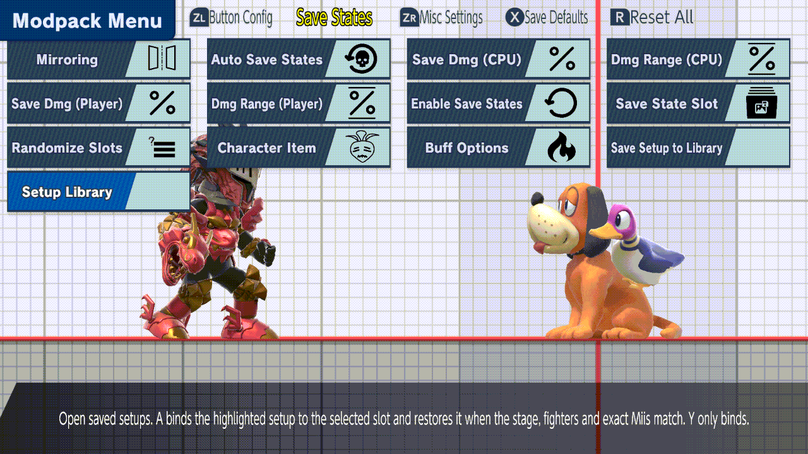
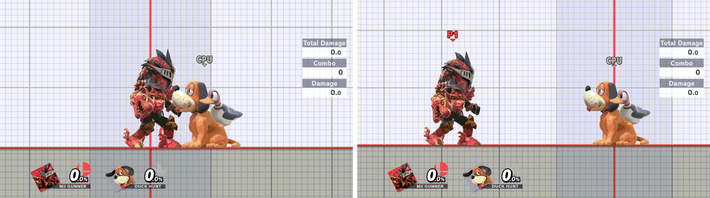

# Setup Library

Give a save-state setup a name, keep it as a small file, and put it into any of
the five Save State Slots later. You can share the file with another console.
This is part of the [unstable enhancements alpha](experimental-release.md).
Binding into Slot 3 and restoring from it passed an emulator check. Testing on
a physical console is pending.

## Save

1. Save a state into the selected **Save State Slot** as usual (default
   **ZL + D-pad Down**).
2. Open **Save States → Save Setup to Library**.
3. The keyboard suggests **Setup**. Type a name and confirm.

The file is saved as `sd:/ultimate/TrainingModpack/setups/<name>.json`. It
holds both fighters, the stage, and each Mii Fighter's exact look. Cancel
writes nothing. If the name isn't allowed or the save fails, your text stays in
the keyboard for another try. A Mii Fighter saved before its look was known is
refused; let the Mii finish loading, then save the slot again.

## Put it in a slot

In **Save States**, set **Save State Slot** to the target slot, here **3**.
Then open **Setup Library**. The footer names the slot the setup will go into.

| Button | Effect |
| --- | --- |
| **Y** | Puts the setup in that slot. Nobody moves |
| **A** | Same, then both fighters respawn in its positions. Works only when the stage, both fighters and any exact Miis match |
| **B** | Close |

The slot is written when you close the menu:

## Load it

Load the slot as usual (default **ZL + D-pad Up**). Here P1 walked over to
Duck Hunt, and loading Slot 3 put both fighters back at the saved spacing:

*Emulator footage. Left and right are two moments from one recording, 3 s apart.*

## When A refuses

A is checked when you press it and again just before the slot is written. If
anything differs, nothing changes and a notice says why. Use **Y** instead.

- `Different stage; use Y to bind`
- `Setup is Mii Gunner vs Duck Hunt; use Y to bind`
- `Player 1 exact Mii differs; use Y to bind`
- `Enable save states first, or use Y to bind`

## Files

- The format is versioned JSON (`schema_version` 1). It holds positions,
  damage, facing, ground/air/ledge situation, charges, Steve's state, the
  Player's held item, the stage ID and each exact Mii. It contains no memory
  addresses.
- File names come from the setup name: lowercase letters, digits and hyphens.
  A second setup with the same name gets `-2`. Nothing is overwritten.
- To share a setup, copy its `.json` file into the other console's `setups/`
  folder. Unreadable, oversized and newer-version files are skipped in the list.
- Image sources: [SCREENSHOTS.md](setup-library/SCREENSHOTS.md).

To keep **inputs** rather than positions, see
[Share a numbered Record Slot](named-macros.md#share-a-numbered-record-slot).
