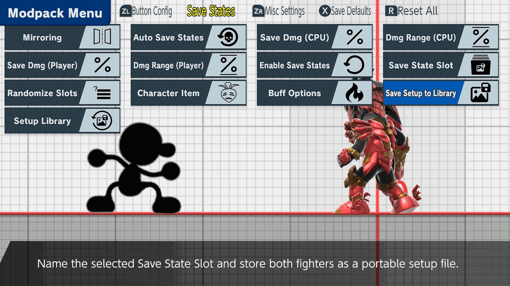
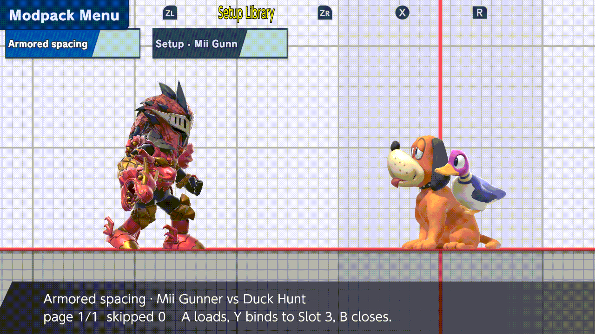
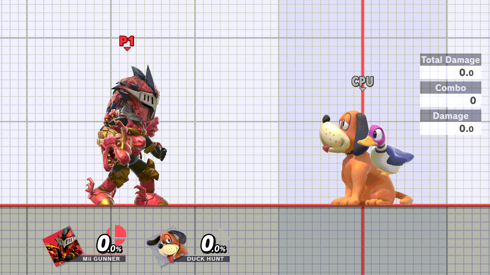

# Setup Library

Name a setup once, then load it into any of the five Save State Slots.
Share its small JSON file with another console.

Available in the [unstable enhancements alpha](experimental-release.md).

## Save

1. Save a state into the selected **Save State Slot** as usual (default
   **ZL + D-pad Down**).
2. Open **Save States → Save Setup to Library**.
3. The keyboard suggests **Setup**. Type a name and confirm.

Saved files go in `sd:/ultimate/TrainingModpack/setups/`. Cancel leaves the library unchanged.

## Put it in a slot

In **Save States**, set **Save State Slot** to the target slot, here **3**.
Then open **Setup Library**. The footer names the slot the setup will go into.

| Button | Effect |
| --- | --- |
| **Y** | Puts the setup in that slot. Nobody moves |
| **A** | Same, then both fighters respawn in its positions. Works only when the stage, both fighters and any exact Miis match |
| **B** | Close |

The slot is written when you close the menu:

## Load it

Load the slot as usual (default **ZL + D-pad Up**). Here P1 walked over to
Duck Hunt, and loading Slot 3 put both fighters back at the saved spacing:

When loading is refused

A is checked when you press it and again just before the slot is written. If
anything differs, nothing changes and a notice says why. Use **Y** instead.

- `Different stage; use Y to bind`
- `Setup is Mii Gunner vs Duck Hunt; use Y to bind`
- `Player 1 exact Mii differs; use Y to bind`
- `Enable save states first, or use Y to bind`

Wait for a Mii to finish loading before saving its setup. If naming or saving
fails, your typed name stays in the keyboard for another try.

File format and sharing

- The format is versioned JSON (`schema_version` 1). It holds positions,
  damage, facing, ground/air/ledge situation, charges, Steve's state, the
  Player's held item, the stage ID and each exact Mii. It contains no memory
  addresses.
- File names come from the setup name: lowercase letters, digits and hyphens.
  A second setup with the same name gets `-2`. Nothing is overwritten.
- To share a setup, copy its `.json` file into the other console's `setups/`
  folder. Unreadable, oversized and newer-version files are skipped in the list.
- Image sources: [SCREENSHOTS.md](setup-library/SCREENSHOTS.md).

To keep **inputs** rather than positions, see
[Share a numbered Record Slot](named-macros.md#share-a-numbered-record-slot).
