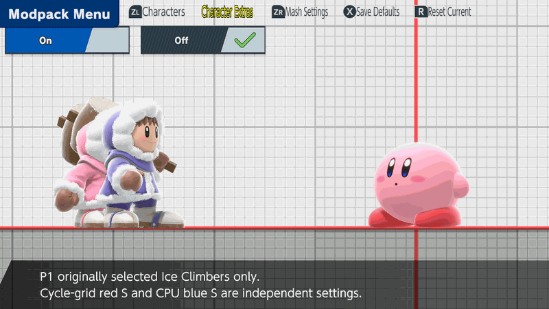

# Solo Popo

Practice as Popo without Nana, or give the CPU the same setup. This feature is
in the [unstable enhancements alpha](experimental-release.md); it is not in the
stable 7.1.2 package.

If you chose Ice Climbers on the game's character-select screen, open
**Character Extras → Solo Popo → On**, then close the modpack menu. The change
applies immediately. Choose Off to bring Nana back.

*Recorded in Linux Eden Training. Young Link is the CPU.*

For Ice Climbers in a character cycle, open **Characters → Character Cycles**,
highlight Ice Climbers, and press **Y**. **ZR** switches which role you edit.

| Setting | Controls |
| --- | --- |
| Character Extras → Solo Popo | P1 who originally selected Ice Climbers |
| Red S, bottom-left of the portrait | P1 who cycles into Ice Climbers |
| Blue S, bottom-right of the portrait | CPU Ice Climbers, originally selected or cycled in |

These settings save independently. An S appears only while its setting is on.
In the enhancements alpha, the original Ice Climbers portrait is grey
only when Character Extras and the red S request the same configuration. When
they differ, add Ice Climbers to the cycle to switch between the pair and Solo
Popo. Slot 0 uses Character Extras; the numbered slot uses the red S. Editing
one preference never overwrites the other. Eden verified original Solo Popo →
numbered paired Ice Climbers → original Solo Popo. Physical-console acceptance
of this refinement remains pending. The refreshed cycle demonstration in the
[hot-swap guide](fighter-hotswap.md) shows both configurations.

The applicable setting switches between Popo alone and the pair when the menu
closes. Player cycling returns through the original slot 0 after the last
numbered fighter. See the [hot-swap guide](fighter-hotswap.md) for the controls
and the [development checks](character-cycles-validation.md) for test coverage.
